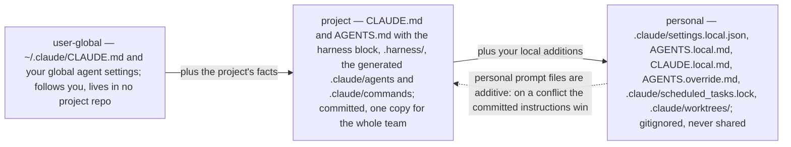

# Shared config and personal config

When a team clones one repository, one question comes up fast: should every developer share the
same `CLAUDE.md`? Yes.

Keep one shared, checked-in `CLAUDE.md` for the whole team; agent CLIs layer personal settings on top of it, so no developer needs a fork.

Project facts are shared and committed; per-developer state is local and gitignored.

Exact contracts — the layer table, the seeded ignores, the personal-file caveats — are in [agents/CONFIG-LAYERING.md](agents/CONFIG-LAYERING.md).

## Where each setting lives

The project layer holds what is true for everyone: architecture, conventions and the harness
entrypoint. The personal layer holds one developer's permissions, local hooks and prompt notes.
The user-global layer holds preferences that follow you across every project, such as your model
and writing style, and lives in no project repository. The generated `.claude/agents/*` and
`.claude/commands/*` belong to the project layer, so commit them and your teammates get the same
commands.

## What the installer ignores for you

The installer seeds or extends the project-root `.gitignore` append-only and ignores specific files under `.claude/`, never the whole directory, so the generated `.claude/agents/*` and `.claude/commands/*` stay tracked and committed.

The personal-layer paths it seeds into the root `.gitignore`:

- `.claude/settings.local.json`
- `.claude/scheduled_tasks.lock`
- `.claude/worktrees/`
- `AGENTS.local.md`
- `CLAUDE.local.md`
- `AGENTS.override.md`

A newly seeded file also carries a commented example for per-tool scratch directories such as `.playwright-mcp/`; add your own lines for the tools you use. Other ignores live elsewhere: the `.harness/.gitignore` the harness seeds covers the local telemetry log, the worker roster below, a Jira PAT file, per-run `progress/` directories and similar machine-local files; and under `--shared-repo` the umbrella root's `.gitignore` also gets one line per child repository.

`.harness/workers.json` is written only while `workers.roster` is on, describes which CLIs your machine can invoke, and is ignored by the installer on every install, gate or no gate.

## Your own prompt notes

Personal prompt files are for guidance that should not become a shared instruction: local house
style, debugging notes, shortcuts. The portable convention is `AGENTS.local.md` at the
repository root; generated entrypoints tell agents to read it only when it exists.

| File | Tool |
|---|---|
| `AGENTS.local.md` | Portable convention, for tools without a native local file |
| `CLAUDE.local.md` | Claude Code |
| `AGENTS.override.md` | Codex |

Personal prompt files (`AGENTS.local.md`, `CLAUDE.local.md`, `AGENTS.override.md`) are additive: when one conflicts with the committed `CLAUDE.md`, `AGENTS.md` or `.harness/AGENTS.md`, the committed instructions remain authoritative.

Do not put architecture, workflow gates, status changes, safety rules or team conventions in
them; put shared facts in the committed entrypoints. If your whole team needs a permission, put
it in the committed `.claude/settings.json` instead of the gitignored local one.

In a fresh worktree, `tools/fix-worktree.sh` links only an existing `.claude/settings.local.json`, `AGENTS.local.md`, `CLAUDE.local.md` or `AGENTS.override.md` from the canonical checkout; `.claude/scheduled_tasks.lock` is never linked, and no other ignored file is.

## In an umbrella

In an umbrella, a thin child's prose body is committed pointer stubs that resolve to the umbrella's copy — still project layer, just short — and `specs/glossary.md` is never a stub.

`feedback.*` in `harness.config.yaml` is project layer and, in an umbrella, is not inherited: each child's own `feedback:` block governs sessions rooted in that child.

## Further reading

- [The three layers](agents/CONFIG-LAYERING.md#the-three-layers) — the layer table and the umbrella rules.
- [What the installer does](agents/CONFIG-LAYERING.md#what-the-installer-does) — the seeded `.gitignore` block.
- [Personal prompt files](agents/CONFIG-LAYERING.md#personal-prompt-files) — the allowlist and the caveats.
- [Practical guidance](agents/CONFIG-LAYERING.md#practical-guidance) — where each kind of setting goes.

See also [UMBRELLA.md](UMBRELLA.md) for umbrellas and [INSTALL.md](INSTALL.md) for the installer.
