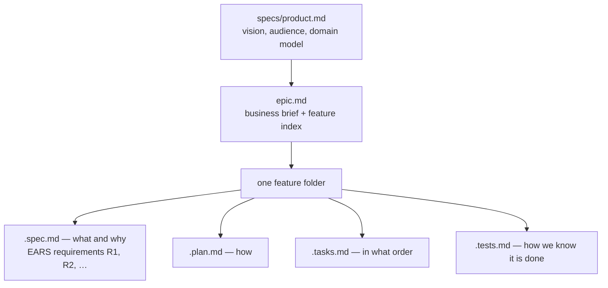

# The spec format

A feature is described by four short files that live next to the code. This page explains them in plain language; the exact grammar the lints and the Reviewer enforce is in [agents/SPEC-FORMAT.md](agents/SPEC-FORMAT.md).

## Product, epic, feature

A product holds epics, an epic holds features, and a feature owns the four files. `specs/product.md` is the stable constitution of the product and `specs/glossary.md` its vocabulary; an epic is a shippable area of value; a feature is one unit a Builder can finish.



Ids nest: `E01` is an epic, `F01` a feature inside it, `R1` a requirement inside the feature's `.spec.md`. Plan rows, tasks and tests cite the requirement they serve (a plan row may cite an ADR instead, and a setup or verify task may cite none), so a reader can follow one requirement from design to test without reading prose. Never renumber a shipped requirement — append a new one.

## The four files

| File | Answers | Written by |
|---|---|---|
| `.spec.md` | what and why: context, business rules, acceptance criteria | Architect |
| `.plan.md` | how: stack, data, interfaces, the files to change and the files not to touch | Architect |
| `.tasks.md` | in what order: one red/green pair per requirement | Architect, worked by the Builder |
| `.tests.md` | how we know it is done: each requirement and the test that verifies it | Architect, checked by the Reviewer |

## Writing a requirement

Acceptance criteria use EARS, a short template per clause, so each clause maps to a test. One requirement is one observable, testable behavior; use `shall` for what must happen. The five patterns:

| Pattern | Shape |
|---|---|
| Ubiquitous | The system shall … |
| Event-driven | **When** something happens, the system shall … |
| State-driven | **While** some state holds, the system shall … |
| Unwanted | **If** a bad thing happens, **then** the system shall … |
| Optional | **Where** a feature is enabled, the system shall … |

Name the component you verify as the system; the user belongs in the trigger. Quantify (`at most 5`, `within 2s`) instead of "fast" or "a few".

## Tasks come in pairs

For every requirement the tasks file holds a pair (an end-to-end requirement that exercises the same code path as another may instead be co-cited on that pair's `a` task): `T<n>a` writes the failing test named in the tests file and observes RED; `T<n>b` writes the minimal code and observes GREEN. The Builder commits after each GREEN. Pairs are ordered walking-skeleton first: the thinnest behavior observable at the product boundary. A refactor task is explicit and cites the requirements whose tests guard it.

## What the lints check

Three tools turn the shape of a spec into an exit code; the Architect runs them before hand-off and the Reviewer rejects on a violation (a file written before the lint existed is flagged instead):

- `tools/tasks-pair-check.py` — the first task that cites a requirement is its `a` task, every requirement is cited, and a task that cites no requirement may not read "write the tests".
- `tools/plan-cite-check.py` — every data row of the plan's four tables (data model, interface, files to change, deferred) cites a requirement or an ADR, and the `## Deferred` subsection is either a table of deferred ADRs or the single line `Deferred: none — <why>`.
- `tools/readiness-check.py` — a backticked path in the first cell of the plan's files table, in a task, or in a tests row or list item must exist or be declared created or deleted, and a `path:name` symbol, or `name()` in a files row naming one existing file, must occur in that file unless the files row creates, adds or deletes; a task or test that says `create` is skipped, and a token the lint does not recognise is ignored, never flagged.

Each lint exits 0 when the shape holds, 1 on a violation and 2 on a usage error; the Reviewer rejects on exit 1 (a file written before the lint existed is flagged instead). A task cites the requirements its test guards, except a setup or verify task, which may cite none.

When the project has an architecture (`specs/architecture.md` and ADRs), the spec also carries an `## Architecture alignment` section that cites each ADR the feature touches; `ADRs touched: none` is a legitimate line when it touches none. When the project has no architecture, the section is not required and nothing is fabricated.

## Frontmatter

A `.spec.md` starts with a YAML block the Orchestrator reads without parsing prose:

```yaml
---
id: E01-F01
title: Example feature
epic: E01-example
status: pending          # pending → spec-ready → in-progress → in-review → done
sdd: true                # false = a quick task, no four-file spec
autonomous: false        # true = may bypass the human approval gate
depends_on: []           # feature ids that must be done first
owner: araozmd
---
```

`status` moves `pending → spec-ready → in-progress → in-review → done`; `autonomous: true` may bypass the human approval gate; `depends_on` lists the features that must be done first. [WORKFLOW.md](WORKFLOW.md) has the state machine.

## Further reading

The exact grammar, with the edge cases the lints and the Reviewer enforce:

- [The hierarchy](agents/SPEC-FORMAT.md#the-hierarchy-product--epic--feature) and [ids and traceability](agents/SPEC-FORMAT.md#ids-and-traceability)
- [The four files](agents/SPEC-FORMAT.md#the-four-files)
- [EARS](agents/SPEC-FORMAT.md#ears--the-requirement-syntax) and [writing good EARS](agents/SPEC-FORMAT.md#writing-good-ears)
- [Tasks — red/green pairs per requirement](agents/SPEC-FORMAT.md#tasks--redgreen-pairs-per-requirement)
- [Plan rows cite an R-id or an ADR](agents/SPEC-FORMAT.md#plan-rows-cite-an-r-id-or-an-adr)
- [Architecture alignment](agents/SPEC-FORMAT.md#architecture-alignment--cite-the-adrs-you-touch)
- [Implementation readiness](agents/SPEC-FORMAT.md#implementation-readiness--every-named-path-resolves)
- [Frontmatter](agents/SPEC-FORMAT.md#frontmatter-machine-readable-state)
