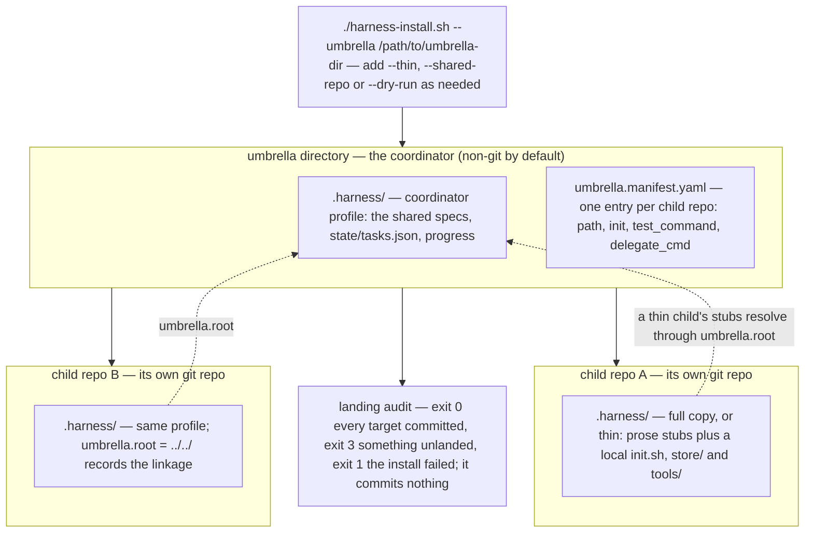
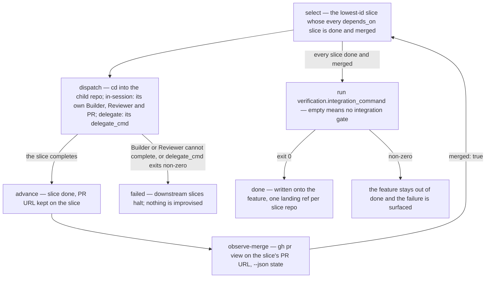

# One feature across several repositories

A product that spans several repositories keeps one spec in an umbrella and hands each
repository its slice of the work. The umbrella orders the slices, holds a slice back until the
ones it depends on have merged, and rolls the result up into one verdict for the feature.

Exact contracts — the exit codes, the tier table, the six-step loop and the manifest keys — are in [agents/UMBRELLA.md](agents/UMBRELLA.md).

## What the umbrella is

The umbrella is a parent directory that hosts the coordinator's `.harness/` and the child
repositories side by side. It is not a git repository by default, and each child stays its own
repository.

Umbrella mode is engaged only when `umbrella.manifest` in `harness.config.yaml` points at a manifest file that exists; with the key unset or the file absent, the coordinator is inert and the single-repo flow runs unchanged.

The umbrella never writes source code: each slice is built, reviewed and opened as a PR by the child repo's own SDD loop, and the umbrella only orders, dispatches, gates and rolls up.

Four words carry the model:

- **Umbrella** — the parent directory with the coordinator's `.harness/`: the shared specs, the
  board and the progress notes.
- **Slice** — one repository's share of a cross-repo feature. It has its own status, a
  `merged` flag, the URL of the PR its repository opened, and `depends_on` links to other
  slices.
- **Manifest** — `umbrella.manifest.yaml`: one entry per child repository, with its path and
  the commands the coordinator runs there.
- **Contract** — the one artifact that pins the seam between repositories, such as an API
  fragment or an event schema. The shared spec names it once, and every slice's tasks and tests
  point at it, so builders in different repositories agree on the shape.

## Set it up

One command stands the umbrella up, from the harness checkout:

```bash
./harness-install.sh --umbrella /path/to/umbrella-dir
```

It installs the coordinator profile into `<umbrella>/.harness/`, finds the immediate children
that are `git` repositories (one level down), installs the normal child profile into each whose
directory name matches `[a-z0-9-]+` (any other is skipped with a warning) and fills
`umbrella.manifest.yaml`. Run it again whenever you add a child: it is idempotent and
never clobbers a manifest entry that is already filled in. Add `--dry-run` to see what it
would do; it writes nothing.



Writing an upgrade is not landing it: the installer can print a green banner while children
hold harness files that nobody has committed.

The cascade ends with a landing audit: it exits `3` when a target holds uncommitted harness-owned paths and `1` when the install itself failed; it never commits, and `--dry-run` skips it.

Expect `exit 3` on a fresh cascade into git children, since nothing is committed yet. A target
that is not a git work tree, such as the default non-git umbrella root, is reported and never
counted as unlanded. Commit the harness files in each child yourself.

The manifest's `test_command` and `delegate_cmd` per entry, and the coordinator's
`integration_command`, are filled in during bootstrap. The coordinator reads each entry's
`path:` relative to the directory holding the manifest.

## Thin children and full copies

A child can carry a full copy of the harness body or a thin one. The line between the two is
drawn by what reads the file: an agent follows a pointer, a program cannot.

A thin child keeps pointer stubs for the prose tier — `AGENTS.md`, `agents/`, `docs/`, `specs/_templates/` — and a full local copy of the program tier — `init.sh`, `store/`, `tools/` and the example files; `specs/glossary.md` is neither: a real, local file in every layout.

The generated front-end glue (such as `.claude/`, `.agents/`, `.opencode/`, `.codex/` and `.pi/`) is local too. The
cascade records the link as `umbrella.root` in each child's `harness.config.yaml`.

A child entered on its own still runs `init.sh`, its verification gate and its PR loop; when the umbrella is unreachable, `init.sh` says so and exits zero.

What degrades is an agent session started in a child that was separated from its umbrella: it
reads a stub that names a path it cannot open, and the stub names the recovery step.

To convert a child that already holds a full copy, ask for it:

```bash
./harness-install.sh --umbrella /path/to/umbrella-dir --thin
```

`--thin` is required for a child's first conversion; a prose-tier file converts only when it is byte-identical to the umbrella's copy, the child converts whole or not at all, and an unreachable umbrella converts nothing and is never fatal.

A child that was behind is named and upgraded by that run, so run the command until it
converges: normally once, twice when children were behind. After a child is thin, later
cascades maintain it without the flag. A run that does not pass `--thin` never converts a full-copy child: it reports what it would convert, and it still re-installs that child's prose tier from source. So do not run an unflagged cascade as a preview before migrating — it destroys the very differences it reports.

To go back, run `./harness-install.sh --standalone /path/to/child`.

`--standalone` re-materialises the full body from the installer's own source and clears `umbrella.root`; it is not a permanent opt-out — the next cascade re-records the key, and only a run that passes `--thin` converts the child again.

## A shared spec repository

By default the umbrella is a throwaway parent directory, so the planning state lives on
whoever ran the cascade. For a team, version-control the umbrella root instead:

```bash
./harness-install.sh --umbrella /path/to/umbrella-dir --shared-repo
```

`--shared-repo` runs `git init` at the umbrella root only when it has no `.git` yet and append-seeds the root `.gitignore` to exclude the child repos; each child stays its own repository, never a gitlink.

The root then tracks `.harness/` and the umbrella docs, and teammates clone it to get the
shared specs and task state, then clone the product repositories beside it. The flag only
decides whether the root is version-controlled; the manifest still drives slice dispatch. The
board is shared state now, so commit `.harness/` changes together with the feature they
describe. Omit the flag and the umbrella behaves as before.

## How a cross-repo feature runs

The coordinator walks a feature's slices in dependency order. A slice is dispatched only when
every slice it depends on is `done` and merged; the loop below is the Orchestrator's, and no
role is forked for it. How a slice is dispatched depends on the Builder backend in the
umbrella's `harness.config.yaml`: under `in-session` the Orchestrator drives the child's own
loop from inside the child repository, and under `delegate` it runs the manifest entry's
`delegate_cmd`, invoked verbatim with the feature id and the absolute spec path.



Each slice's tasks and tests reference the one pinned contract, so the slices agree on the
seam they share. A slice that completes is recorded as `done` and keeps its PR URL; that does
not unblock its dependents, which wait for the merge. The coordinator checks the merge with
`gh pr view` on the PR URL. A slice that fails is marked `failed`, its dependents stop, and
the coordinator surfaces the failure instead of improvising a fix. A slice that names a
repository the manifest does not declare is refused.

A cross-repo feature is `done` only when every slice is `done` and `merged` and `verification.integration_command` exits zero; an empty `integration_command` means there is no integration gate.

While any slice is not done, the integration command does not run. When it exits non-zero the
feature stays out of `done` and the failure is surfaced. When the feature is `done`, the
coordinator writes that onto the feature together with one landing reference per slice
repository, which is checked against that repository's default branch; the exact rules are in
the workflow contract.

## From one repo to a coordinator

A single install can become a coordinator without starting over. When the architecture names more than one deployable, the Planner leaves a draft manifest at `.harness/umbrella.manifest.draft.yaml`; promotion turns it into the live one.

`--from-manifest <file>` with `--umbrella <dir>` promotes an existing single install into a coordinator from the Planner's draft manifest; each entry key must equal its child directory's basename, and promotion runs `git init` locally and adds no remote.

Add `--dry-run` to preview a promotion; it writes nothing. Promotion creates each missing
child, re-bases each entry's `path:` onto the umbrella root and keeps an entry that already
exists. The root keeps its own board, specs and progress, and no child-local board is written.
The remote work is still yours: a GitHub remote, branch protection and the Codex App.

## Further reading

Each section of [agents/UMBRELLA.md](agents/UMBRELLA.md) holds the exact contract behind this
guide.

- [Opt-in switch](agents/UMBRELLA.md#opt-in-switch-single-repo-stays-inert) — what engages umbrella mode.
- [Installing the umbrella](agents/UMBRELLA.md#installing-the-umbrella-cascade) — the cascade and the landing audit's exit table.
- [The thin child](agents/UMBRELLA.md#the-thin-child-v0540) — the tier table and standalone entry.
- [Migrating an existing child](agents/UMBRELLA.md#migrating-an-existing-child---thin) — the pristine rule and the all-or-nothing refusal.
- [`--standalone`](agents/UMBRELLA.md#--standalone--the-way-back) — the way back to a full copy.
- [Shared spec repository](agents/UMBRELLA.md#shared-spec-repository-opt-in) — the steps `--shared-repo` runs.
- [Concepts](agents/UMBRELLA.md#concepts) — umbrella, slice, manifest and the two path bases.
- [Spec home and slices](agents/UMBRELLA.md#spec-home--umbrella-slices--child-repos) — where the shared spec lives.
- [Contract artifact](agents/UMBRELLA.md#contract-artifact-one-contract-no-drift) — the one pinned seam.
- [The coordinator loop](agents/UMBRELLA.md#the-coordinator-loop-dispatch--gating) — the six steps and both dispatch modes.
- [Integration verification](agents/UMBRELLA.md#integration-verification-rollup) — when a feature may be `done`.
- [Promoting a single install](agents/UMBRELLA.md#promoting-a-single-install-to-a-coordinator) — the refusals and the re-basing.
- [Manifest reference](agents/UMBRELLA.md#manifest-reference) — the keys of one entry.

See also [INSTALL.md](INSTALL.md) for the installer, [CONFIG-LAYERING.md](CONFIG-LAYERING.md) for what is shared and what is
personal, and [WORKFLOW.md](WORKFLOW.md) for how a single repository's work moves.
