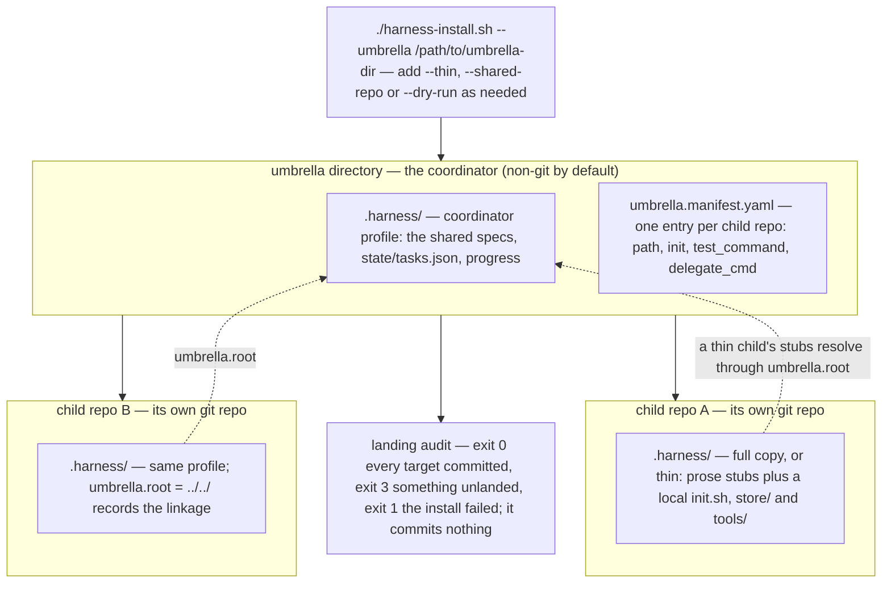
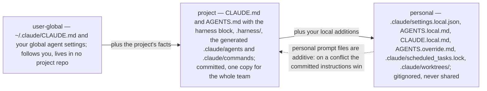

# Docs for humans, slice 4: UMBRELLA + CONFIG-LAYERING split — Technical Plan

> Translates the .spec.md intent into design. Every table row cites the `R-id`(s) it serves
> or the `ADR-NNNN` that defers it (ADR-0009) — this plan must exit `0` under
> `tools/plan-cite-check.py` and the feature directory under `tools/readiness-check.py`
> (every first cell below exists today or has `create` as the first word of its Change cell).
> The Builder reads `progress/lessons.md` first (the 2026-11-13 slice-1 lessons apply directly:
> grep every absolute in a human doc against the contract that owns it; plant one defect per
> scan-set member). Exact prose the Builder pastes is in *Approach notes → Exact text*, inside
> fenced blocks (fenced text is invisible to the readiness lint). A relative link target
> written in this file outside a fence carries a `<docs>/` or `<agents>/` placeholder so the
> lint does not read it as a repository path.

## Stack & dependencies

- Language/framework: Markdown + Mermaid (GitHub-rendered); POSIX `sh` + `awk` + `python3`
  (stdlib only) inside `tests/test_docs_for_humans.sh`, run under dash by `tools/run-tests.sh`.
  The two slice-1 tools are **used, not changed** (D6).
- New dependencies: **none**. No mermaid-cli.
- Inputs: `docs/UMBRELLA.md` and `docs/CONFIG-LAYERING.md` at the merge base
  (`git show <base>:docs/UMBRELLA.md`, `git show <base>:docs/CONFIG-LAYERING.md`) are the
  sources of the two counterparts — copy them, never retype them. No art.
- Repo root for every command: the `feat/E39-F04-umbrella-config-split` worktree, rebased on
  `origin/main` (`f4586654`, VERSION `0.112.0`). `BASE="$(git merge-base origin/main HEAD)"`.
  Board writes carry `HARNESS_DIR=<worktree>`; the Builder never writes the board.
- **Test-runner slot.** One `run-tests.sh` at a time on this machine, `--jobs ≤ 4`. While
  iterating run only the suites you touched, one at a time (`sh tests/test_docs_for_humans.sh`
  first, then each re-pointed suite in the coupling table, then `sh tests/test_install.sh`,
  `sh tests/test_suite_hygiene.sh`, `sh tests/test_self_drift.sh`). The full
  `sh tools/run-tests.sh` once, serially, before hand-off; never relaunch a killed run.
  `TMPDIR` for the suites: a path with no ancestor relationship to the repo
  (`/var/tmp/E39-F04-builder/`, created first).

## Data model  (serves: R1, R2, R3, R4, R5, R6, R7, R9, R11)

No stored state. The data model is the set of file contracts the suite reads.

| Entity | Form (byte-exact where quoted) | Where the grammar is silent | R-id |
|---|---|---|---|
| UMBRELLA counterpart | `docs/agents/UMBRELLA.md`: line 1 `# Umbrella coordinator (cross-repo features)`; first non-empty line after it the announcement (text A); then the 0.112 body verbatim | the announcement is the only added text; blank lines around it are free | R1 |
| UMBRELLA heading list | the ordered `#`/`##`/`###` lines outside fenced code — exactly the 19 lines of *Heading list (UMBRELLA)* | no `####` occurs in the base doc; the base has no Mermaid block; its fenced `bash`/text blocks stay | R1 |
| UMBRELLA retargeted links | from `docs/agents/`: `#shared-spec-repository-opt-in` and `#migrating-an-existing-child---thin` kept; `<docs>/../agents/reviewer.md#what-you-check` → `<agents>/../../agents/reviewer.md#what-you-check`; `<docs>/./agents/INSTALL.md#umbrella-mode-cascade-install` → `<agents>/INSTALL.md#umbrella-mode-cascade-install`; `<docs>/../specs/adr/0004-umbrella-resolved-body-via-pointer-stubs.md` → `<agents>/../../specs/adr/0004-…`; `<docs>/../umbrella.gitignore.example` → `<agents>/../../umbrella.gitignore.example`; `<docs>/./CONFIG-LAYERING.md` → `<agents>/../CONFIG-LAYERING.md` | link **text** never changes (C2); exactly these five targets differ from base; backtick tokens (`agents/orchestrator.md`, `store/local.md`, `docs/agents/WORKFLOW.md`) are root-relative and untouched | R1 |
| CONFIG-LAYERING counterpart | `docs/agents/CONFIG-LAYERING.md`: line 1 `# Config layering — shared vs personal`; then the announcement (text B); then the 0.112 body verbatim, its fenced `gitignore` block included | same | R2 |
| CONFIG-LAYERING heading list | the ordered `#`/`##` lines outside fenced code — exactly the 5 lines of *Heading list (CONFIG-LAYERING)* | the `# Per-tool MCP …` and `#.playwright-mcp/` lines sit inside the fence and are not headings | R2 |
| CONFIG-LAYERING retargeted links | `<docs>/./UMBRELLA.md` (line 4, plain) → `<agents>/../UMBRELLA.md`; `<docs>/./UMBRELLA.md` (line 28, `→ *The thin child*`) → `<agents>/UMBRELLA.md`; `<docs>/./INSTALL.md` → `<agents>/../INSTALL.md`; `<docs>/./agents/INSTALL.md#worker-roster-workersroster--opt-in-local-only` → `<agents>/INSTALL.md#worker-roster-workersroster--opt-in-local-only` | exactly these four targets differ from base | R2 |
| move proof | `tools/docs-move-check.sh "$BASE"`: exit 0; summary `0 vanished tokens, 2 dropped lines, <M> moved lines, 3 human docs examined`; the three are `docs/UMBRELLA.md`, `docs/CONFIG-LAYERING.md`, `docs/RATIONALE.md`; the two `DROPPED-LINE` lines name `docs/RATIONALE.md:116` and `:118` | `<M>` is not pinned; the Reviewer runs it (a suite never diffs `main`) | R1 |
| human UMBRELLA | `docs/UMBRELLA.md`: H1 on line 1; counterpart link `](agents/UMBRELLA.md)` within lines 1–15; the seven `##` headings of R3 in order and no other `##`; `###` free | ≤250 lines; registered `docs/UMBRELLA.md:250:yes` (text H) | R3, R11 |
| human CONFIG-LAYERING | `docs/CONFIG-LAYERING.md`: H1 on line 1; `](agents/CONFIG-LAYERING.md)` within lines 1–15; the five `##` headings of R6 in order and no other `##` | ≤100 lines; registered `docs/CONFIG-LAYERING.md:100:yes` (text H) | R6, R11 |
| further-reading anchors | `](agents/UMBRELLA.md#<slug>)` for each of the 13 `##` slugs of the UMBRELLA counterpart (R3); `](agents/CONFIG-LAYERING.md#<slug>)` for the 4 `##` slugs of the CONFIG-LAYERING counterpart (R6); slugs computed by the `tools/doc-cite-check.py` rule from the heading lists | written in `## Further reading`; one per line is easiest to lint but not required | R3, R6 |
| layout diagram | `## Set it up`: one fence whose info string is `mermaid`, first content line starts `flowchart`, the nine tokens of R4; the section prose names `exit 3`, `--dry-run`, `git` | text C; the Builder may add nodes, never drop a pinned token | R4 |
| loop diagram | `## How a cross-repo feature runs`: one `mermaid` fence, `flowchart`, the eight tokens of R4; exactly one line matches the R4 `done`-edge regex (the spec's spelling is canonical — a `\|` in a table cell here is only the Markdown pipe escape) and it contains `integration_command`; the prose names `slices`, `contract`, `in-session`, `delegate` | text D; same freedom | R4 |
| layers diagram | `## Where each setting lives`: one `mermaid` fence, `flowchart`, the ten tokens of R6; the prose names `project`, `personal`, `user-global` | text E | R6 |
| sentence pins | U1–U10 (text F), L1–L8 (text G), each matched by the regex in the *Accuracy tables*, applied to the doc folded to one line outside fences | wording outside the regex is free; the regex is the contract | R5, R7 |
| over-claims | none of the eleven strings in R5's list in `docs/UMBRELLA.md`; none of the nine in R7's list in `docs/CONFIG-LAYERING.md`; case-insensitive, outside fences | — | R5, R7 |
| code citations | `agents/architect.md`, `agents/orchestrator.md`, `store/local.md`, `harness.config.yaml`, `umbrella.manifest.example.yaml`: zero `docs/UMBRELLA.md`; `harness-install.sh`: exactly two `docs/UMBRELLA.md` lines (text K names them) and exactly one `docs/CONFIG-LAYERING.md` line; the eight re-pointed installer lines read as text K | no emitter changes; `--self` leaves the tree clean | R9 |
| registry entries | `HUMAN_DOCS` gains `docs/UMBRELLA.md:250:yes docs/CONFIG-LAYERING.md:100:yes` | both under the default 300, so no `# why:` comment | R11 |
| index rows | text I, appended under the WORKFLOW row | the "What moved" cell is free text | R11 |

## API / interface  (serves: R3, R4, R5, R6, R7, R8, R9, R10, R11, R12)

| Interface | Shape | R-id |
|---|---|---|
| `tests/test_docs_for_humans.sh` new rows | functions `F04_R1_counterpart_announcement`, `F04_R1_counterpart_headings_in_order`, `F04_R1_counterpart_retargets`, `F04_R2_cl_counterpart_announcement`, `F04_R2_cl_counterpart_headings_in_order`, `F04_R2_cl_counterpart_retargets`, `F04_R3_umbrella_shape`, `F04_R4_umbrella_diagrams`, `F04_R5_umbrella_sentences`, `F04_R5_umbrella_no_over_claims`, `F04_R6_cl_shape_and_diagram`, `F04_R7_cl_sentences`, `F04_R7_cl_no_over_claims`, `F04_R8_suites_cite_counterparts`, `F04_R9_code_citations`, `F04_R10_sibling_citations`, `F04_R11_registry_and_index`, `F04_R12_version_and_changelog`; dispatched from the flat list under a `# ---- E39-F04` comment; the dispatch-completeness sweep already matches `F04_` names | R1–R12 |
| `tests/test_docs_for_humans.sh` reused helpers (D6) | `shape_problems <file> <## headings> <anchors> <counterpart-basename>` called with this slice's lists (`HUMAN_UM_HEADS`/`HUMAN_UM_ANCHORS`, `HUMAN_CL_HEADS`/`HUMAN_CL_ANCHORS`); `diagram_problems <doc> <heading> <tokens> <prose>` (type `flowchart`, the default) called three times; `unfenced`, `folded`, `slice`, `mirror`, `index_rows`, `link_targets` as they stand; no new shape or diagram helper | R3, R4, R6 |
| `tests/test_docs_for_humans.sh` generalised helper (D6) | `f02_changelog_problem` and `f03_changelog_problem` → one `changelog_problem <file> <feature-id> <paths…>` (variadic: the feature id and every path given must occur in the section; the awk body unchanged except that its token regexes come from the arguments; dots escaped by the function); `F02_R11_version_and_changelog`, `F03_R10_version_and_changelog` and `F04_R12_version_and_changelog` call it; the two old names do not survive | R12 |
| `tests/test_docs_for_humans.sh` new small helpers | `um_accuracy_problems <file>`, `um_over_claims <file>`, `cl_accuracy_problems <file>`, `cl_over_claims <file>` (the slice-3 `wf_*` shape with this slice's pins); `um_suite_problems <root>`, `um_code_problems <root>`, `um_sibling_problems <root>` (each takes a root so a mutant mirror can be scanned) | R5, R7, R8, R9, R10 |
| `tests/test_docs_for_humans.sh` edited row | `F03_R8_sibling_citations` / `wf_sibling_problems <root>`: the loop `for _f in docs/RATIONALE.md docs/UMBRELLA.md` and the landing-record grep read `docs/agents/UMBRELLA.md`; the mutant setup seds the mirror's `docs/agents/UMBRELLA.md`; the mutant's `grep` now matches the message `landing-record pointer does not name docs/agents/WORKFLOW.md` (the loop message also names the file, so the file name alone was reachable by either path); nothing else in the row changes | R11 |
| `tests/test_install.sh` | `test_docs_for_humans_installed_contract()`'s `cmp -s` loop gains `docs/UMBRELLA.md docs/agents/UMBRELLA.md docs/CONFIG-LAYERING.md docs/agents/CONFIG-LAYERING.md` (same loop, four more names); the installed-copy sites re-point per the *Suite coupling table*; the existence check `[ -f "$T/.harness/docs/CONFIG-LAYERING.md" ]` stays | R8, R11 |
| re-pointed suites | `sed 's#docs/UMBRELLA\.md#docs/agents/UMBRELLA.md#g'` on `tests/test_planner_topology.sh`, `tests/test_promote.sh`, `tests/test_umbrella_01_coordinator.sh`, `tests/test_umbrella_13_standalone.sh`; `sed 's#docs/CONFIG-LAYERING\.md#docs/agents/CONFIG-LAYERING.md#g'` on `tests/test_feedback_config.sh`; on `tests/test_install.sh` both seds **except** the existence-check line (apply both seds, then restore that one line, or edit the other 26 lines by hand); run **once, before** the R11 loop extension; patterns, anchors and fail-message wording untouched (C3) | R8 |
| `agents/architect.md`, `agents/orchestrator.md`, `store/local.md`, `harness.config.yaml`, `umbrella.manifest.example.yaml` | whole-file `sed 's#docs/UMBRELLA\.md#docs/agents/UMBRELLA.md#g'` (every token in these five files is a citation of moved content: 1, 1, 1, 4, 2 lines) | R9 |
| `harness-install.sh` | eight lines re-point by hand (text K): the three header comments (76, 94, 115), the two config-migration strings (158, 163), the glossary comment (4489), the printed usage line (4824), the `--shared-repo` comment (10870); the `Full model:` comment (4659) → `.harness/docs/agents/CONFIG-LAYERING.md`; lines 192, 4685 and 10103 untouched; then `sh harness-install.sh --self` and `git status --porcelain` empty | R9 |
| sibling docs | `docs/RATIONALE.md:116`: `` [`docs/UMBRELLA.md`](UMBRELLA.md) `` → `` [`docs/agents/UMBRELLA.md`](agents/UMBRELLA.md) ``; `:118`: `` [`docs/CONFIG-LAYERING.md`](CONFIG-LAYERING.md) `` → `` [`docs/agents/CONFIG-LAYERING.md`](agents/CONFIG-LAYERING.md) ``; `docs/agents/INSTALL.md:1001`, `:1020`, `:1052`: `(../UMBRELLA.md#<slug>)` → `(UMBRELLA.md#<slug>)`, slug unchanged | R10 |
| `docs/agents/README.md` | two index rows (text I) appended under the WORKFLOW row; the plain pointers on lines 543 and 549 and the layout listing on line 347 untouched | R11 |
| `VERSION` / `CHANGELOG.md` | `0.112.0` → `0.113.0` unless `origin/main` moved (`git show origin/main:VERSION` before the final rebase; always next MINOR, patch 0); `## [0.113.0] — <date>` with text J | R12 |

**Decision — the counterparts are copies, not compositions (D1).** `git show "$BASE":docs/UMBRELLA.md > docs/agents/UMBRELLA.md`, insert text A after line 1, apply only the five link retargets; the same for CONFIG-LAYERING with text B and four retargets. Anything else is a C2 violation and `docs-move-check.sh` shows it as a `DROPPED-LINE` for the human doc, which R1 forbids.
**Decision — the citation class decides (D2).** The spec's decision table is the rule; this plan lists every site it yields. A site not in the table is a finding, not a judgment call.
**Decision — one sed per suite (R8).** Every human-path token in a re-pointing suite moves, fail messages included — except the one installed-file existence check; the `uniq -u` command in R8 is what proves nothing else moved.
**Decision — pins are one- or two-token regexes on folded text (R5, R7).** A regex that needs the load-bearing tokens of the sentence in order, so a reworded sentence that keeps the meaning passes and a dropped exception reds.
**Decision — no feature ids, no version markers in the human docs.** The archaeology lint forbids ids; the two version markers in the base headings (`v0.52.0`, `v0.54.0`) are on R5's over-claim list so the human doc says "since the audit shipped" or nothing.

## Files to change  (serves: R1–R12)

| File | Change | R-id |
|---|---|---|
| `docs/agents/UMBRELLA.md` | **create** — `git show "$BASE":docs/UMBRELLA.md`, then insert text A as a blockquote after the H1 (one blank line each side), then retarget exactly the five link targets of the *Data model → UMBRELLA retargeted links* row. Nothing else differs from base | R1 |
| `docs/agents/CONFIG-LAYERING.md` | **create** — `git show "$BASE":docs/CONFIG-LAYERING.md`, then insert text B after the H1, then retarget exactly the four link targets of the *Data model → CONFIG-LAYERING retargeted links* row. Nothing else differs from base | R2 |
| `docs/UMBRELLA.md` | **rewrite** — ≤250 lines; the human guide per *Human doc skeleton (UMBRELLA)*: H1, intro with the counterpart link, the seven `##` sections of R3, diagrams text C (in `## Set it up`) and text D (in `## How a cross-repo feature runs`), sentences U1–U10 (text F) in their sections, `## Further reading` with the 13 anchors; no link target outside `docs/`; none of R5's over-claims; no feature ids | R3, R4, R5 |
| `docs/CONFIG-LAYERING.md` | **rewrite** — ≤100 lines; per *Human doc skeleton (CONFIG-LAYERING)*: H1, intro with the counterpart link, the five `##` sections of R6, diagram text E (in `## Where each setting lives`), sentences L1–L8 (text G), `## Further reading` with the four anchors; no link outside `docs/`; none of R7's over-claims; no feature ids | R6, R7 |
| `docs/agents/README.md` | **modify** — append the two index rows (text I) under the WORKFLOW row; lines 347, 543, 549 untouched | R11 |
| `docs/agents/INSTALL.md` | **modify** (D2, path-only) — the three anchored UMBRELLA links: `(../UMBRELLA.md#promoting-a-single-install-to-a-coordinator)` → `(UMBRELLA.md#promoting-a-single-install-to-a-coordinator)`, `(../UMBRELLA.md#shared-spec-repository-opt-in)` → `(UMBRELLA.md#shared-spec-repository-opt-in)`, `(../UMBRELLA.md#migrating-an-existing-child---thin)` → `(UMBRELLA.md#migrating-an-existing-child---thin)`; the plain `(../UMBRELLA.md)` and `(../CONFIG-LAYERING.md)` links stay | R10 |
| `docs/RATIONALE.md` | **modify** (D4, path-only) — the D11 and D13 ledger rows: the "where it lives" link label and target each gain `agents/` (two lines, nothing else) | R10 |
| `agents/architect.md` | **modify** (path-only) — `(see \`docs/UMBRELLA.md\`)` → `(see \`docs/agents/UMBRELLA.md\`)` in the umbrella-mode paragraph | R9 |
| `agents/orchestrator.md` | **modify** (path-only) — `Full model: \`docs/UMBRELLA.md\`.` → `Full model: \`docs/agents/UMBRELLA.md\`.` | R9 |
| `store/local.md` | **modify** (path-only) — the slice-semantics pointer `specified in \`docs/UMBRELLA.md\`` → `docs/agents/UMBRELLA.md` | R9 |
| `harness.config.yaml` | **modify** (path-only) — the four comment lines (`integration_command`, the `umbrella:` block header, `→ Manifest reference`, the `root:` comment): `docs/UMBRELLA.md` → `docs/agents/UMBRELLA.md`; this is the seed the installer copies, so a fresh install's config carries the new path | R9 |
| `umbrella.manifest.example.yaml` | **modify** (path-only) — the two comment lines (the switch sentence, `→ Manifest reference`) | R9 |
| `harness-install.sh` | **modify** — the nine lines of text K (eight UMBRELLA, one CONFIG-LAYERING); no emitter and no other printed string touched; then `sh harness-install.sh --self` must produce no diff | R9 |
| `tests/test_docs_for_humans.sh` | **modify** — registry entries text H; the generalised `changelog_problem` and its three callers per *API*; `wf_sibling_problems` re-pointed per *API*; new rows and helpers per *API*; the header comment gains one line naming E39-F04 | R1, R2, R3, R4, R5, R6, R7, R8, R9, R10, R11, R12 |
| `tests/test_install.sh` | **modify** (C3 + R11) — the installed-copy sites of both docs → `.harness/docs/agents/…` (26 lines; the existence check on line 1051 stays); `test_docs_for_humans_installed_contract()` loop gains the four names | R8, R11 |
| `tests/test_feedback_config.sh` | **modify** (C3) — the `folded_section '## The three layers'` read and its two guard lines | R8 |
| `tests/test_planner_topology.sh` | **modify** (C3) — `DOC="$SRC/docs/UMBRELLA.md"` and the R9 comment above the constants | R8 |
| `tests/test_promote.sh` | **modify** (C3) — `UMBRELLA_DOC=`, its presence check, the promotion-section comment and its guard message | R8 |
| `tests/test_umbrella_01_coordinator.sh` | **modify** (C3) — `DOC=` and the four R7/R8 fail messages | R8 |
| `tests/test_umbrella_13_standalone.sh` | **modify** (C3) — the `f04_docs_contract` comment, `F04DOC=`, two section-absence fails and the pass line | R8 |
| `VERSION` | **bump** to the next MINOR over the then-current `origin/main` value (`0.112.0` today ⇒ `0.113.0`). Before bumping, `grep -rn '0\.112\.0' tests/ tools/ init.sh harness-install.sh` — expect none; keep it so | R12 |
| `CHANGELOG.md` | **prepend** `## [0.113.0] — <date>` (text J) | R12 |

## Deferred  (ADR-0009 — bolt-ons the stage excludes)

Stage: `production` (this repo's `specs/product.md`).

Deferred: none — stage is production, and this feature's runtime surface is documentation
plus rows in a read-only lint; no bolt-on NFR applies to it.

## DO NOT TOUCH

- `README.md`, `AGENTS.md`, `CLAUDE.md`, `docs/CONCEPTS.md`, `docs/BRAND.md`, `docs/INSTALL.md`,
  `docs/README.md`, `docs/WORKFLOW.md`, `docs/agents/WORKFLOW.md`, `docs/SPEC-FORMAT.md`,
  `docs/HARNESS.md`, `docs/ABLATION.md`, `docs/BASELINE-0.78.1.md`, `init.sh`, every `tools/*`
  (the two slice-1 tools included — D6), `tests/lib/*`, `tests/fixtures/*`, `state/tasks.json`,
  `specs/_templates/`, `assets/`.
- Every `agents/*.md` line other than the one citing line each in `agents/architect.md` and
  `agents/orchestrator.md`; every `store/*` line other than the one in `store/local.md`.
- `docs/RATIONALE.md` — F05's file: byte-identical before and after **except** the two lines
  R10 names (`git diff --numstat "$BASE" -- docs/RATIONALE.md` prints `2 2`). Record `cksum` of
  every untouched doc at T0 and at hand-off, never `git diff … main` inside a suite.
- Every suite not named in *Files to change*; inside the named suites, every line that is not a
  human-path site (C3), and the one installed-file existence check in `tests/test_install.sh`.
- `.claude/**`, `.codex/**`, `.opencode/**`, `.pi/**`, `.agents/**` — generated; nothing in them
  cites either doc, and `sh harness-install.sh --self` is run only to prove the tree is clean.
- The moved text in both counterparts — copied, never edited (the nine link targets excepted).
- `harness-install.sh` lines 192, 4685 and 10103 (the three kept citations, D3).

## Approach notes

### Suite coupling table (R8)

Every suite that reads either doc, its sites, and the disposition. Line numbers are those of
the merge base and are a finding aid only — grep the pattern, do not trust the number. Counts
are lines containing the token `docs/UMBRELLA.md` or `docs/CONFIG-LAYERING.md` (a bare
`UMBRELLA.md` / `CONFIG-LAYERING.md` in a label, comment or fail message is not a path and is
untouched by the sed).

| Suite | Sites (base line) | What it pins | Disposition |
|---|---|---|---|
| `tests/test_install.sh` (UMBRELLA) | 3236 (comment), 3237 (`doc_section` on the **installed** copy), 3238, 3240, 3242 (fails) | R11: the `The thin child` section's `**Prose**` row names no glossary; the `glossary.md … neither tier` sentence | re-point ×5 |
| `tests/test_install.sh` (CONFIG-LAYERING) | 513, 515, 517, 522, 524, 529, 531 (installed greps in three `test_config_layering_*` functions); 1068, 1070, 1072, 1074, 1076, 1078, 1080, 1082, 1084 (installed greps); 3244 (comment), 3245 (`doc_section` installed), 3246, 3257, 3259 (fails) | `personal prompt`, `AGENTS.local.md`, `additive`, `CLAUDE.local.md`, `AGENTS.override.md`, `fresh worktrees`, `native local-file support differs by CLI`, `.claude/worktrees/`, `absolute symlink`; the `The three layers` pointer-stub sentence names no glossary | re-point ×21 |
| `tests/test_install.sh` (marker) | 1051 (`[ -f "$T/.harness/docs/CONFIG-LAYERING.md" ]`) | the file the seeded `.gitignore` header cites is installed | **keep** |
| `tests/test_feedback_config.sh` | 419 (`folded_section '## The three layers'`), 420 (guard fail), 426 (pass) | R10: `` `feedback:` block governs sessions rooted in that child ``, `**not inherited**` | re-point ×3 |
| `tests/test_planner_topology.sh` | 21 (comment), 69 (`DOC=`) | R9: the `Manifest reference` section names `scaffold_cmd`, `optional`, `opaque` | re-point ×2 |
| `tests/test_promote.sh` | 23 (`UMBRELLA_DOC=`), 36 (presence fail), 165 (comment), 168 (guard fail) | R1: the `Promoting a single install to a coordinator` section's six tokens and nine sentence pairs (`re-base`, `local git`, `fails closed`, `physical`, `promotion requires`, `remedy`, `scaffold_cmd`, `landing audit`) | re-point ×4 |
| `tests/test_umbrella_01_coordinator.sh` | 403 (`DOC=`), 404, 405, 406, 409 (fails) | R7/R8: `contract artifact`, `exactly one`, `Every emitted slice` | re-point ×5 |
| `tests/test_umbrella_13_standalone.sh` | 207 (comment), 211 (`F04DOC=`), 222, 240 (fails), 247 (pass) | `f04_docs_contract`: every cascade invocation in the migration section carries `--thin`; `until it converges`; `whole or not at all`; `does not resolve to an installed harness body`; `--standalone` shows the command, `cleared`, `not a permanent opt-out` | re-point ×5 |
| `tests/test_docs_for_humans.sh` | 1682 (loop), 1687 (grep), 1703 (mutant sed), 1704 (fail) | slice 3's `F03_R8_sibling_citations`: the landing-record pointer inside UMBRELLA names `docs/agents/WORKFLOW.md` | re-point ×4 (own suite, R11) |

Bare names that stay: `tests/test_planner_topology.sh:537`, `:574`, `:575`; `tests/test_promote.sh:169`,
`:188` (the required token `UMBRELLA.md` in INSTALL's promotion section still occurs — the
retargeted link `UMBRELLA.md#promoting-…` contains it); `tests/test_feedback_config.sh:422`,
`:424`; 17 `tests/test_install.sh` fail/pass messages.

### Accuracy table — UMBRELLA (R5)

Each human sentence, the counterpart section that owns the fact, and the regex the suite applies
to the human doc folded to one line outside fences. The Builder re-reads the owning section
before writing the sentence; a sentence that cannot be traced is not written. Where a sentence
enumerates, the owning table is named and every member is listed (D5).

| Id | Human sentence (text F) | Owning section in `docs/agents/UMBRELLA.md` | Regex pins |
|---|---|---|---|
| U1 | engaged only when `umbrella.manifest` points at a manifest file that exists; otherwise inert, single-repo flow unchanged | `## Opt-in switch (single-repo stays inert)` | `engaged only when` **and** `coordinator is inert` |
| U2 | the umbrella never writes source code; each slice is built, reviewed and opened as a PR by the child repo's own SDD loop | intro ¶2; `## The coordinator loop` ("In **both** modes the umbrella **never edits source files** … the child repo's own SDD loop owns implementation, its PR, and its review") | `never writes source code` **and** `child repo.s own` |
| U3 | `done` only when every slice is `done` and `merged` and `integration_command` exits zero; empty command ⇒ no integration gate | `## Integration verification (rollup)` (Gated / Run / Done / Failure) | `every slice is .done. and .merged.` **and** `no integration gate` |
| U4 | landing audit: exit `3` unlanded, `1` install failed; never commits; `--dry-run` skips it | `### The landing audit — "complete" means committed` (exit table, "The audit never commits") | `never commits` **and** `--dry-run. skips` |
| U5 | prose tier = `AGENTS.md`, `agents/`, `docs/`, `specs/_templates/` → stubs; program tier = `init.sh`, `store/`, `tools/` **and the example files** → local copy; `specs/glossary.md` neither: a real, local file in every layout | `## The thin child (v0.54.0+)` — the tier table (both rows, every path) and the glossary paragraph | `pointer stubs` **and** `real,? local file in every layout` |
| U6 | a child entered on its own runs `init.sh`, its verification gate, its PR loop; unreachable umbrella ⇒ `init.sh` says so and exits zero | `### Standalone entry still works — that is the acceptance bar` | `on its own` **and** `says so and exits zero` |
| U7 | `--thin` required for the first conversion; byte-identical pristine rule; whole or not at all; unreachable umbrella converts nothing, never fatal | `## Migrating an existing child (--thin)`, `### Pristine-only, and all-or-nothing`, `### An unreachable umbrella converts nothing, and is never fatal` | `whole or not at all` **and** `never fatal` |
| U8 | `--standalone` re-materialises the body from the installer's own source and clears `umbrella.root`; not a permanent opt-out — the next cascade re-records the key; only a `--thin` run converts again | `## --standalone — the way back` (both closing paragraphs) | `clears .umbrella\.root.` **and** `not a permanent opt-out` |
| U9 | `--shared-repo`: `git init` only when the root has no `.git` yet; append-seeds the root `.gitignore`; each child its own repo, never a gitlink | `## Shared spec repository (opt-in)` steps 1–2 | `only when it has no .\.git. yet` **and** `never a gitlink` |
| U10 | `--from-manifest <file>` with `--umbrella <dir>` promotes an existing single install from the Planner's draft; key equals child directory basename; local `git init`, no remote | `## Promoting a single install to a coordinator` ¶1, ¶3, ¶4 | `equal[^.]{0,40}basename` **and** `adds no remote` |

Over-claims the row forbids (case-insensitive, outside fences): `monorepo`, `commits for you`,
`merges for you`, `always converts`, `converts every child`, `done as soon as`, `boolean flag`,
`v0.52.0`, `v0.54.0`, `E99-F102`, `left alone by every run`.

### Accuracy table — CONFIG-LAYERING (R7)

| Id | Human sentence (text G) | Owning section in `docs/agents/CONFIG-LAYERING.md` | Regex pins |
|---|---|---|---|
| L1 | project facts are shared and committed; per-developer state is local and gitignored | intro ¶3 | `shared and committed` **and** `local and gitignored` |
| L2 | keep one shared, checked-in `CLAUDE.md`; CLIs layer personal settings on top, so no fork | intro ¶3 | `one shared, checked-in` |
| L3 | personal prompt files are additive; on conflict the committed `CLAUDE.md`, `AGENTS.md`, `.harness/AGENTS.md` remain authoritative | `## Personal prompt files` ¶1 | `are additive:` **and** `remain authoritative` |
| L4 | installer seeds/extends the root `.gitignore` append-only; specific files under `.claude/`, never the whole directory; generated `.claude/agents/*`, `.claude/commands/*` stay tracked | `## What the installer does`; `## The three layers` ¶4 | `append-only` **and** `specific files` |
| L5 | `feedback.*` is project layer; in an umbrella not inherited — each child's own `feedback:` block governs | `## The three layers` ¶5 | `not inherited` **and** `child.s own .feedback:. block governs` |
| L6 | `tools/fix-worktree.sh` links only an existing `.claude/settings.local.json`, `AGENTS.local.md`, `CLAUDE.local.md` or `AGENTS.override.md` (all four named); `.claude/scheduled_tasks.lock` never linked; no other ignored file | `## Personal prompt files` — the two caveats | `links only` **and** `never linked` |
| L7 | `.harness/workers.json` written only while `workers.roster` is on; describes which CLIs your machine can invoke; ignored on every install, gate or no gate | `## Practical guidance` last bullet | `workers\.roster` **and** `every install, gate or no gate` |
| L8 | a thin child's prose body is committed pointer stubs resolving to the umbrella's copy — still project layer; `specs/glossary.md` never a stub | `## The three layers` ¶2 | `still project layer` **and** `never a stub` |

Over-claims the row forbids: `one CLAUDE.md per developer`, `overrides the project`,
`local file wins`, `every ignored file`, `ignores the whole`, `inherits feedback`, `E30-F01`,
`E32-F01`, `Two ignores`.

### Heading list (UMBRELLA) (R1)

The 19 heading lines of the 0.112 `docs/UMBRELLA.md` in order, byte for byte — the counterpart's
`unfenced | grep '^#'` output must equal this block exactly:

```text
# Umbrella coordinator (cross-repo features)
## Opt-in switch (single-repo stays inert)
## Installing the umbrella (cascade)
### The landing audit — "complete" means committed
## The thin child (v0.54.0+)
### Standalone entry still works — that is the acceptance bar
### What this does and does not change
## Migrating an existing child (`--thin`)
### Pristine-only, and all-or-nothing
### An unreachable umbrella converts nothing, and is never fatal
## `--standalone` — the way back
## Shared spec repository (opt-in)
## Concepts
## Spec home = umbrella; slices = child repos
## Contract artifact (one contract, no drift)
## The coordinator loop (dispatch + gating)
## Integration verification (rollup)
## Promoting a single install to a coordinator
## Manifest reference
```

### Heading list (CONFIG-LAYERING) (R2)

The 5 heading lines of the 0.112 `docs/CONFIG-LAYERING.md` in order (the two `#` lines inside
the fenced `gitignore` block are not headings):

```text
# Config layering — shared vs personal
## The three layers
## What the installer does
## Personal prompt files
## Practical guidance
```

### Human doc skeleton (UMBRELLA) (R3–R5)

Write it short, not trimmed afterwards. Every claim comes from the counterpart section named
in brackets; link that section from `## Further reading` when it is not in the body. No feature
ids, no version markers, no filler phrases (the suite's list), no link that leaves `docs/`.

- **H1 + intro (lines 1–8).** `# One feature across several repositories` — one paragraph: a
  product that spans repos keeps one spec in an umbrella and hands each repo its slice; the
  umbrella orders the work, gates it on merges and rolls the result up; U1 and U2 sit here or in
  the first section. Second paragraph, one line:
  `Exact contracts — the exit codes, the tier table, the six-step loop and the manifest keys — are in [agents/UMBRELLA.md](agents/UMBRELLA.md).`
- **`## What the umbrella is`** — the parent directory, non-git by default; a slice is one
  repo's share of a feature with its own status, `merged` flag and PR; the manifest maps each
  repo to a path and commands; the one contract artifact every slice references
  [`## Concepts`, `## Spec home = umbrella; slices = child repos`, `## Contract artifact`]. U1
  here if not in the intro.
- **`## Set it up`** — the command `./harness-install.sh --umbrella /path/to/umbrella-dir`; it
  installs the coordinator profile, finds the immediate git children (depth 1) and installs each,
  fills `umbrella.manifest.yaml`; text C; U4; the prose names `exit 3`, `--dry-run` and that the
  children are `git` repositories; "re-run any time: idempotent, never clobbers a filled manifest
  entry" [`## Installing the umbrella (cascade)`, `### The landing audit`]. Never write "commits
  for you".
- **`## Thin children and full copies`** — U5 (both tiers, every path); U6; U7; U8; a full-copy
  child is never converted by a run that does not pass `--thin` (it reports what it would convert and still re-installs the prose tier from source) [`## The thin child`,
  `### Standalone entry still works`, `## Migrating an existing child`, `## --standalone`]. Never
  write "always converts" or "converts every child".
- **`## A shared spec repository`** — U9; what it buys (teammates clone the specs and the board,
  then clone the product repos beside them); orthogonal to the manifest; commit `.harness/`
  changes with the feature they describe [`## Shared spec repository (opt-in)`]. Never write
  "monorepo".
- **`## How a cross-repo feature runs`** — text D; U3; one sentence each on `in-session` (the
  Orchestrator drives the child's own loop from inside it) and `delegate` (the manifest's
  `delegate_cmd`, invoked verbatim); `failed` halts the dependents and improvises nothing; the
  prose names `slices`, `contract`, `in-session`, `delegate` [`## The coordinator loop`,
  `## Integration verification`]. Never write "done as soon as".
- **`## From one repo to a coordinator`** — U10; preview with `--dry-run`; the human still owes
  the remote work (a GitHub remote, branch protection, the Codex App)
  [`## Promoting a single install to a coordinator`].
- **`## Further reading`** — one line per `##` of the counterpart (13), each saying in a few
  words what the section decides; plus `INSTALL.md`, `CONFIG-LAYERING.md`, `WORKFLOW.md`.

### Human doc skeleton (CONFIG-LAYERING) (R6–R7)

- **H1 + intro (lines 1–6).** `# Shared config and personal config` — the question ("one
  `CLAUDE.md` for the team?"), L2 as the answer, L1 as the rule; one line:
  `Exact contracts — the layer table, the seeded ignores, the personal-file caveats — are in [agents/CONFIG-LAYERING.md](agents/CONFIG-LAYERING.md).`
- **`## Where each setting lives`** — text E; one short paragraph naming the three layers by
  the words `project`, `personal`, `user-global` [`## The three layers` table].
- **`## What the installer ignores for you`** — L4; the six paths the root `.gitignore` is seeded
  with, as a bullet list (`.claude/settings.local.json`, `.claude/scheduled_tasks.lock`,
  `.claude/worktrees/`, `AGENTS.local.md`, `CLAUDE.local.md`, `AGENTS.override.md`) — and,
  stated as separate ignores, not part of that six: `.harness/workers.json` (L7) and the runtime
  scratch the `.harness/.gitignore` covers (`telemetry.jsonl`) plus per-tool MCP scratch dirs
  [`## What the installer does`, `## Practical guidance`]. Never write "ignores the whole".
- **`## Your own prompt notes`** — L3; the portable convention `AGENTS.local.md`, the native
  files per CLI (the three-row table may be reproduced); what belongs there and what does not
  (no architecture, gates, status changes, safety rules, team conventions); L6
  [`## Personal prompt files`]. Never write "overrides the project" or "local file wins".
- **`## In an umbrella`** — L8; L5 [`## The three layers` ¶2, ¶5]. Never write "inherits
  feedback".
- **`## Further reading`** — the four `##` anchors of the counterpart; plus `UMBRELLA.md`,
  `INSTALL.md`.

### Sequencing

1. T0 cksums (every DO-NOT-TOUCH doc, every `agents/*.md`, `store/*`, `tools/*`, `README.md`,
   every suite not in the coupling table). Create both counterparts by **copying** the base
   files (`git show`), insert texts A and B, retarget the nine links — do the moves before the
   human docs so `docs-move-check.sh "$BASE"` is your own red/green signal (`0 vanished tokens`
   once the human docs are rewritten; before that, `0 human docs examined`).
2. Re-point the six suites (one `sed` each, `tests/test_install.sh` with its one kept line); run
   each suite one at a time; confirm the shape with the R8 `git diff -U0 … | uniq -u` command
   (no survivors yet; after step 3, exactly the two `for _f in` lines).
3. Registry entries, index rows, `wf_sibling_problems` re-point, installed-contract extension;
   `sh tests/test_docs_for_humans.sh` now reds on the human docs (counterpart link, budget) —
   write both human docs per the skeletons.
4. Role prompts, store, installer, the two seeds (text K) + `sh harness-install.sh --self`;
   `docs/RATIONALE.md` and the three `docs/agents/INSTALL.md` anchors; `python3
   tools/doc-cite-check.py` exit 0.
5. New rows (shape, diagrams, pins, citations), the `changelog_problem` refactor,
   VERSION/CHANGELOG, `--self` again (empty diff), full suite.

### Exact text

**Text A — UMBRELLA announcement (lines 1–3 of `docs/agents/UMBRELLA.md`; line 1 is the base H1):**

```markdown
# Umbrella coordinator (cross-repo features)

> For agents — exact contracts; the human guide is [docs/UMBRELLA.md](../UMBRELLA.md).
```

**Text B — CONFIG-LAYERING announcement (lines 1–3 of `docs/agents/CONFIG-LAYERING.md`):**

```markdown
# Config layering — shared vs personal

> For agents — exact contracts; the human guide is [docs/CONFIG-LAYERING.md](../CONFIG-LAYERING.md).
```

**Text C — the layout diagram (`## Set it up`; the Builder may add nodes, never drop a pinned token):**



**Text D — the slice-loop diagram (`## How a cross-repo feature runs`; only one edge may target `done`, and that line names `integration_command`):**

```mermaid
flowchart TB
    select["select — the lowest-id slice whose every depends_on slice is done and merged"] --> dispatch
    dispatch["dispatch — cd into the child repo; in-session: its own Builder, Reviewer and PR; delegate: its delegate_cmd"] -->|"the slice completes"| advance["advance — slice done, PR URL kept on the slice"]
    dispatch -->|"Builder or Reviewer cannot complete, or delegate_cmd exits non-zero"| failed["failed — downstream slices halt; nothing is improvised"]
    advance --> observe["observe-merge — gh pr view on the slice's PR URL, --json state"]
    observe -->|"merged: true"| select
    select -->|"every slice done and merged"| integ
    integ["run verification.integration_command — empty means no integration gate"] -->|"exit 0"| done["done — written onto the feature, one landing ref per slice repo"]
    integ -->|"non-zero"| red["the feature stays out of done and the failure is surfaced"]
```



**Text E — the layers diagram (`## Where each setting lives`):**



**Text F — the ten pinned UMBRELLA sentences (paste; surrounding prose is free):**

```markdown
U1   Umbrella mode is engaged only when `umbrella.manifest` in `harness.config.yaml` points at a manifest file that exists; with the key unset or the file absent, the coordinator is inert and the single-repo flow runs unchanged.
U2   The umbrella never writes source code: each slice is built, reviewed and opened as a PR by the child repo's own SDD loop, and the umbrella only orders, dispatches, gates and rolls up.
U3   A cross-repo feature is `done` only when every slice is `done` and `merged` and `verification.integration_command` exits zero; an empty `integration_command` means there is no integration gate.
U4   The cascade ends with a landing audit: it exits `3` when a target holds uncommitted harness-owned paths and `1` when the install itself failed; it never commits, and `--dry-run` skips it.
U5   A thin child keeps pointer stubs for the prose tier — `AGENTS.md`, `agents/`, `docs/`, `specs/_templates/` — and a full local copy of the program tier — `init.sh`, `store/`, `tools/` and the example files; `specs/glossary.md` is neither: a real, local file in every layout.
U6   A child entered on its own still runs `init.sh`, its verification gate and its PR loop; when the umbrella is unreachable, `init.sh` says so and exits zero.
U7   `--thin` is required for a child's first conversion; a prose-tier file converts only when it is byte-identical to the umbrella's copy, the child converts whole or not at all, and an unreachable umbrella converts nothing and is never fatal.
U8   `--standalone` re-materialises the full body from the installer's own source and clears `umbrella.root`; it is not a permanent opt-out — the next cascade re-records the key, and only a run that passes `--thin` converts the child again.
U9   `--shared-repo` runs `git init` at the umbrella root only when it has no `.git` yet and append-seeds the root `.gitignore` to exclude the child repos; each child stays its own repository, never a gitlink.
U10  `--from-manifest <file>` with `--umbrella <dir>` promotes an existing single install into a coordinator from the Planner's draft manifest; each entry key must equal its child directory's basename, and promotion runs `git init` locally and adds no remote.
```

**Text G — the eight pinned CONFIG-LAYERING sentences:**

```markdown
L1   Project facts are shared and committed; per-developer state is local and gitignored.
L2   Keep one shared, checked-in `CLAUDE.md` for the whole team; agent CLIs layer personal settings on top of it, so no developer needs a fork.
L3   Personal prompt files (`AGENTS.local.md`, `CLAUDE.local.md`, `AGENTS.override.md`) are additive: when one conflicts with the committed `CLAUDE.md`, `AGENTS.md` or `.harness/AGENTS.md`, the committed instructions remain authoritative.
L4   The installer seeds or extends the project-root `.gitignore` append-only and ignores specific files under `.claude/`, never the whole directory, so the generated `.claude/agents/*` and `.claude/commands/*` stay tracked and committed.
L5   `feedback.*` in `harness.config.yaml` is project layer and, in an umbrella, is not inherited: each child's own `feedback:` block governs sessions rooted in that child.
L6   In a fresh worktree, `tools/fix-worktree.sh` links only an existing `.claude/settings.local.json`, `AGENTS.local.md`, `CLAUDE.local.md` or `AGENTS.override.md` from the canonical checkout; `.claude/scheduled_tasks.lock` is never linked, and no other ignored file is.
L7   `.harness/workers.json` is written only while `workers.roster` is on, describes which CLIs your machine can invoke, and is ignored by the installer on every install, gate or no gate.
L8   In an umbrella, a thin child's prose body is committed pointer stubs that resolve to the umbrella's copy — still project layer, just short — and `specs/glossary.md` is never a stub.
```

**Text H — the registry line (`tests/test_docs_for_humans.sh`):**

```sh
HUMAN_DOCS="README.md:150:yes docs/README.md:60:no docs/CONCEPTS.md:220:yes docs/BRAND.md:90:no docs/INSTALL.md:300:yes docs/WORKFLOW.md:300:yes docs/UMBRELLA.md:250:yes docs/CONFIG-LAYERING.md:100:yes"
```

**Text I — the two index rows (`docs/agents/README.md` → `## Index`, after the WORKFLOW row):**

```markdown
| `docs/UMBRELLA.md` | `docs/agents/UMBRELLA.md` | The whole 0.112 UMBRELLA: the opt-in switch, the cascade and the landing audit, the thin child and its tier table, migrating with `--thin`, `--standalone`, the shared spec repository, concepts, the contract artifact, the coordinator loop, integration verification, promotion and the manifest reference |
| `docs/CONFIG-LAYERING.md` | `docs/agents/CONFIG-LAYERING.md` | The whole 0.112 CONFIG-LAYERING: the three layers, the installer's `.gitignore` seeding, personal prompt files and their caveats, practical guidance |
```

**Text J — CHANGELOG entry skeleton:**

```markdown
## [0.113.0] — <date>

### Changed — docs for humans, slice 4: UMBRELLA + CONFIG-LAYERING split (E39-F04)
- `docs/UMBRELLA.md` rewritten for humans (under 250 lines): the umbrella layout and cascade
  (diagram), thin children, the shared spec repository, the slice loop from select to `done`
  (diagram), promotion.
- `docs/CONFIG-LAYERING.md` rewritten for humans (under 100 lines): the three layers (diagram),
  the seeded ignores, personal prompt files, the umbrella rules.
- `docs/agents/UMBRELLA.md` and `docs/agents/CONFIG-LAYERING.md` — the 0.112 docs moved verbatim
  (every section, headings byte-identical, link targets retargeted). Six suites, the Architect and
  Orchestrator prompts, the store contract, the installer's comments and usage text, the two
  shipped seeds and the sibling-doc pointers re-point by path only.
- `tests/test_docs_for_humans.sh` — one `changelog_problem` helper serves the slice 2, 3 and 4
  release rows.
```

**Text K — the nine `harness-install.sh` lines after the edit (only the path changes on each; the three kept lines are listed last and are not edited):**

```text
# Umbrella mode (--umbrella, see docs/agents/UMBRELLA.md): cascades a single install across
# Body layout (--thin / --standalone, E24-F04, see docs/agents/UMBRELLA.md → "Migrating an
# Shared spec repository (--shared-repo, umbrella mode only, see docs/agents/UMBRELLA.md):
        '  integration_command: ""   # umbrella integration gate (see docs/agents/UMBRELLA.md)'
        printf '  integration_command: ""   # umbrella integration gate (see docs/agents/UMBRELLA.md)\n'
  # entirely; see harness-install.sh's HARNESS_BODY_PROSE comment above and docs/agents/UMBRELLA.md).
                   nothing. See docs/agents/UMBRELLA.md -> "Migrating an existing child".
      # Umbrella mode only; validated below. See docs/agents/UMBRELLA.md "Shared spec repository".
  # .harness/docs/agents/CONFIG-LAYERING.md.
--- kept, byte-identical ---
      printf '# Telemetry (E05-F02): local-only sub-agent + human-gate timing. See docs/UMBRELLA.md\n'
    { printf '# Personal/runtime agent state — never commit (see .harness/docs/CONFIG-LAYERING.md).\n'
      echo "  This is an umbrella coordinator; see .harness/docs/UMBRELLA.md, then run /sdd-next (\$sdd-next in Codex) from this directory."
```
