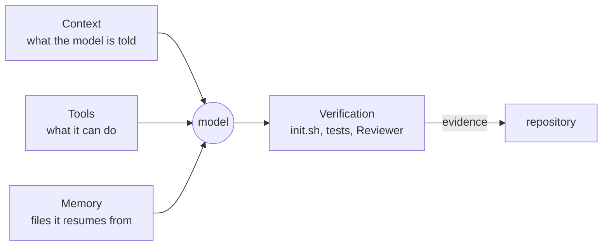
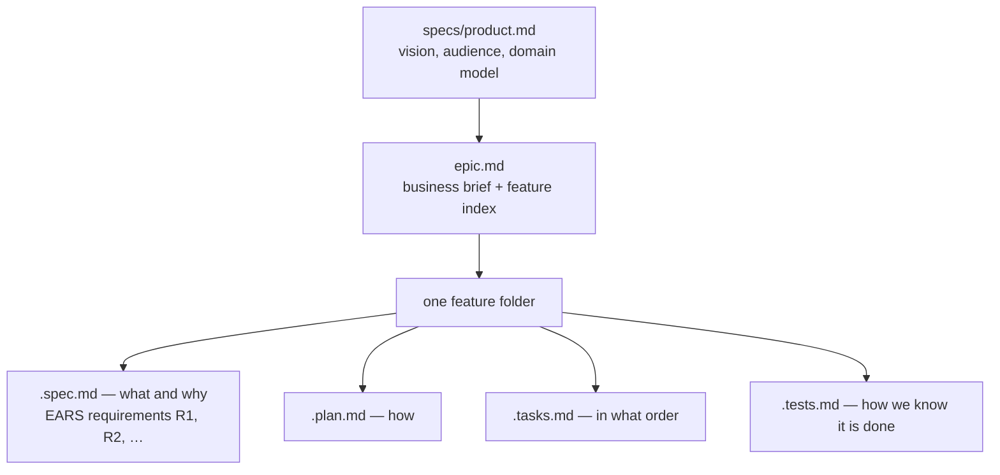
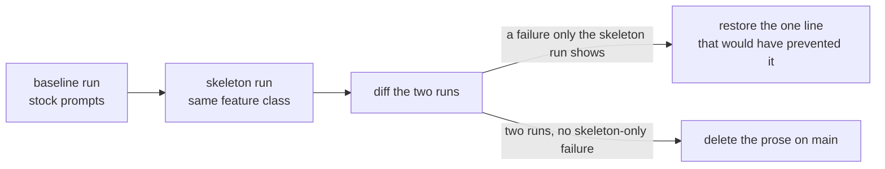

# Docs for humans, slice 5: SPEC-FORMAT split + HARNESS → CONCEPTS + ABLATION trim + BASELINE → history — Technical Plan

> Translates the .spec.md intent into design. Every table row cites the `R-id`(s) it serves or
> the `ADR-NNNN` that defers it (ADR-0009) — this plan must exit `0` under
> `tools/plan-cite-check.py` and the feature directory under `tools/readiness-check.py` (every
> first cell below exists today or has `create` as the first word of its Change cell). The Builder
> reads `progress/lessons.md` first (the 2026-11-13 slice-1 lessons apply directly: grep every
> absolute in a human doc against the contract that owns it; plant one defect per scan-set
> member). Exact prose the Builder pastes is in *Approach notes → Exact text*, inside fenced
> blocks (fenced text is invisible to the readiness lint). A relative link target written in this
> file outside a fence carries a `<docs>/`, `<agents>/` or `<history>/` placeholder so the lint does
> not read it as a repository path.

## Stack & dependencies

- Language/framework: Markdown + Mermaid (GitHub-rendered); POSIX `sh` + `awk` + `python3`
  (stdlib only) inside `tests/test_docs_for_humans.sh`, run under dash by `tools/run-tests.sh`.
  The two slice-1 tools are **used, not changed** (D7).
- New dependencies: **none**. No mermaid-cli.
- Inputs: `docs/SPEC-FORMAT.md`, `docs/HARNESS.md`, `<docs>/BASELINE-0.78.1.md` and
  `docs/ABLATION.md` at the merge base (`git show "$BASE":docs/<NAME>.md`) are the sources of the
  two counterparts, the archive and the trimmed doc — copy them, never retype them. No art.
- Repo root for every command: the `feat/E39-F05-spec-format-split` worktree, rebased on
  `origin/main` after PR #338 merged (VERSION `0.113.0`). `BASE="$(git merge-base origin/main HEAD)"`.
  Board writes carry `HARNESS_DIR=<worktree>`; the Builder never writes the board.
- **Test-runner slot.** One `run-tests.sh` at a time on this machine, `--jobs ≤ 4`. While
  iterating run only the suites you touched, one at a time (`sh tests/test_docs_for_humans.sh`
  first, then each re-pointed suite in the coupling table, then `sh tests/test_install.sh`,
  `sh tests/test_self_drift.sh`, `sh tests/test_suite_hygiene.sh`). The full `sh tools/run-tests.sh`
  once, serially, before hand-off; never relaunch a killed run. `TMPDIR` for the suites: a path with
  no ancestor relationship to the repo (`/var/tmp/E39-F05-builder/`, created first).

## Data model  (serves: R1, R2, R3, R4, R5, R6, R7, R8, R10, R11)

No stored state. The data model is the set of file contracts the suite reads.

| Entity | Form (byte-exact where quoted) | Where the grammar is silent | R-id |
|---|---|---|---|
| SPEC-FORMAT counterpart | `docs/agents/SPEC-FORMAT.md`: line 1 `# The Spec Format`; line 2 blank; line 3 the announcement (text A); line 4 blank; then base lines 3–248 verbatim (base line 2 is the blank after the H1 and is the one kept at line 2) | the base has no Markdown link, so there is no retarget; its fenced `yaml`/`markdown`/text blocks stay; in bash `diff <(git show "$BASE":docs/SPEC-FORMAT.md) docs/agents/SPEC-FORMAT.md` shows two added lines | R1 |
| SPEC-FORMAT heading list | the ordered `#`/`##`/`###` lines outside fenced code — exactly the 11 lines of *Heading list (SPEC-FORMAT)* | the `## Deferred` lines inside the two fenced `markdown` examples are not headings; no `####` occurs | R1 |
| HARNESS counterpart | `docs/agents/HARNESS.md`: line 1 `# What a harness is (and why this one is built this way)`; then the announcement (text B) at line 3 between two blank lines; then base lines 3–122 verbatim with eight link targets retargeted | link **text** never changes (C2); exactly the eight targets of *HARNESS retargeted links* differ from base; the backtick tokens (`AGENTS.md`, `.pi/prompts/`, `tools/pi-dispatch.sh` …) are root-relative and untouched | R2 |
| HARNESS retargeted links | `<docs>/RATIONALE.md` → `<agents>/../RATIONALE.md` (base lines 10 and 119); `<docs>/WORKFLOW.md` → `<agents>/../WORKFLOW.md` (57); `<docs>/INSTALL.md` → `<agents>/../INSTALL.md` (85); `<docs>/agents/INSTALL.md#starting-from-nothing-new-product` → `<agents>/INSTALL.md#starting-from-nothing-new-product` (73); `<docs>/agents/INSTALL.md#self-mode----self-harness-developers-only` → `<agents>/INSTALL.md#self-mode----self-harness-developers-only` (111); `<docs>/agents/INSTALL.md#retiring-gemini` → `<agents>/INSTALL.md#retiring-gemini` (115); `<docs>/../specs/product.md` → `<agents>/../../specs/product.md` (121) | a plain link keeps its identity (`../WORKFLOW.md`, `../INSTALL.md`, `../RATIONALE.md` are the human docs); the three anchored INSTALL links already pointed at the counterpart and only lose their `agents/` prefix | R2 |
| HARNESS heading list | the ordered `#`/`##` lines outside fenced code — exactly the 5 lines of *Heading list (HARNESS)* | the base holds no `###`; its one fenced block is the command table's neighbour, not a heading source | R2 |
| archive | `docs/history/BASELINE-0.78.1.md`: line 1 `# Implemented baseline — 0.78.1`; then the history blockquote (text C) at line 3 between two blank lines; then base lines 3–51 verbatim with four link targets retargeted; `<docs>/BASELINE-0.78.1.md` absent | `git mv` keeps the rename visible to `git log --follow`; `docs-move-check.sh` reads the pair as one removed doc whose lines are found under `docs/history/` (moved) | R3 |
| archive retargeted links | `<docs>/INSTALL.md` → `<history>/../INSTALL.md` (11); `<docs>/agents/INSTALL.md#layout--ownership` → `<history>/../agents/INSTALL.md#layout--ownership` (38); `<docs>/../store/README.md` → `<history>/../../store/README.md` and `<docs>/../store/board-mirror.md` → `<history>/../../store/board-mirror.md` (44) | exactly these four targets differ from base | R3 |
| history lint treatment | `history_problems <root>`: for every `<root>/docs/history/*.md`, `docs/README.md` holds `](history/<name>)`, and `HUMAN_DOCS` holds no token starting `docs/history/` | history files are not index rows, not registry entries, and carry no budget | R3 |
| move proof | `tools/docs-move-check.sh "$BASE"`: exit 0; summary `0 vanished tokens, 1 dropped lines, <M> moved lines, 7 human docs examined`; the seven are the four moved or trimmed docs plus `docs/CONCEPTS.md`, `docs/README.md`, `docs/RATIONALE.md`; the one `DROPPED-LINE` names `docs/RATIONALE.md:106` | `<M>` is not pinned; the Reviewer runs it (a suite never diffs `main`) | R1 |
| human SPEC-FORMAT | `docs/SPEC-FORMAT.md`: H1 on line 1; `](agents/SPEC-FORMAT.md)` within lines 1–15; the seven `##` headings of R4 in order and no other `##`; `###` free; text F is the whole file | ≤120 lines; registered `docs/SPEC-FORMAT.md:120:yes` (text J) | R4, R11 |
| further-reading anchors | `](agents/SPEC-FORMAT.md#<slug>)` for each of the eight `##` slugs of the counterpart (R4); the two `###` slugs (`#ids-and-traceability`, `#writing-good-ears`) may also be linked | slugs computed by the `tools/doc-cite-check.py` rule from *Heading list (SPEC-FORMAT)* | R4 |
| hierarchy diagram | `## Product, epic, feature`: one fence whose info string is `mermaid`, first content line starts `flowchart`, the seven tokens of R5; the section prose names `E01`, `F01`, `glossary.md` | text F carries it; the Builder may add nodes, never drop a pinned token | R5 |
| sentence pins | S1–S9 (text F, listed in *Accuracy table — SPEC-FORMAT*), P1–P2 (text D), C1–C6 (text E), each matched by its regex applied to the doc folded to one line outside fences | wording outside the regex is free; the regex is the contract | R5, R6, R7 |
| over-claims | none of the ten strings of R5 in `docs/SPEC-FORMAT.md`; none of the thirteen of R7 in `docs/CONCEPTS.md`; none of the six of R8 in `docs/ABLATION.md`; case-insensitive (R5, R7) or case-sensitive (R8), outside fences | — | R5, R7, R8 |
| pointer page | `docs/HARNESS.md` is text D byte for byte: 13 lines, H1 `# What a harness is`, no `##`, the counterpart link on line 3, the three onward links | ≤20 lines; registered `docs/HARNESS.md:20:no` (text J) | R6, R11 |
| CONCEPTS section | `## What a harness is` (text E) inserted after the intro paragraph and before `## The loop`; two sentences of the `## Specs` paragraph reworded (text E, last block) | ≤220 lines (the slice-1 budget); the six slice-1 headings keep their order after the new one | R7 |
| components diagram | `## What a harness is`: one `mermaid` fence, `flowchart`, the six tokens of R7; the prose names `engine`, `chassis`, `Bash` | text E | R7 |
| trimmed ABLATION | `docs/ABLATION.md` is text G byte for byte: the base H1, the doctrine pointer line, the base method paragraph, `## Protocol` with the diagram and the five base steps, the three skeletons under `###` headings without suffixes, the sheet, the constraints | ≤100 lines; registered `docs/ABLATION.md:100:yes` (text J); the row asserts the three constraints bullets; byte-identity of the kept sections is the Reviewer's `diff` against the base (no base copy lives in the suite) | R8 |
| code citations | the six files of R10 hold zero `docs/SPEC-FORMAT.md`; `harness-install.sh` holds exactly one `SPEC-FORMAT.md` line (text N); `AGENTS.md` holds the re-pointed sentence and both rows (text N) | `--self` regenerates `.claude/agents/architect.md`; the tree is then clean | R10 |
| registry entries | `HUMAN_DOCS` gains `docs/SPEC-FORMAT.md:120:yes docs/HARNESS.md:20:no docs/ABLATION.md:100:yes` — the token grammar is `<path>:<line-budget>:<diagram yes\|no>` (the suite's header comment) | all under the default 300, so none needs the `# why:` comment the header requires above an over-300 entry | R11 |
| index rows + history note | text K, appended under the CONFIG-LAYERING row, plus the paragraph after the table | the "What moved" cell is free text | R11 |

## API / interface  (serves: R3, R4, R5, R6, R7, R8, R9, R10, R11, R12)

| Interface | Shape | R-id |
|---|---|---|
| `tests/test_docs_for_humans.sh` new rows | functions `F05_R1_counterpart_announcement`, `F05_R1_counterpart_headings_in_order`, `F05_R2_harness_counterpart_announcement`, `F05_R2_harness_counterpart_headings_in_order`, `F05_R2_harness_counterpart_retargets`, `F05_R3_history_archive`, `F05_R4_specformat_shape`, `F05_R5_specformat_diagram`, `F05_R5_specformat_sentences`, `F05_R5_specformat_no_over_claims`, `F05_R6_harness_pointer_page`, `F05_R7_concepts_harness_section`, `F05_R7_concepts_sentences`, `F05_R7_concepts_no_over_claims`, `F05_R8_ablation_trimmed`, `F05_R9_suites_cite_counterparts`, `F05_R10_code_citations`, `F05_R11_sibling_citations`, `F05_R11_registry_and_index`, `F05_R12_version_and_changelog`; dispatched from the flat list under a `# ---- E39-F05` comment; the dispatch-completeness sweep already matches `F05_` names | R1–R12 |
| `tests/test_docs_for_humans.sh` reused helpers (D7) | `shape_problems <file> <## headings> <anchors> <counterpart-basename>` with `HUMAN_SF_HEADS`/`HUMAN_SF_ANCHORS`; `diagram_problems <doc> <heading> <tokens> <prose>` (type `flowchart`) called three times (SPEC-FORMAT, CONCEPTS, ABLATION); `changelog_problem <file> <feature-id> <paths…>` for R12; `unfenced`, `folded`, `slice`, `mirror`, `index_rows`, `link_targets`, `has_heading` as they stand; no new shape or diagram helper | R4, R5, R7, R8, R12 |
| `tests/test_docs_for_humans.sh` new small helpers | `sf_accuracy_problems <file>`, `sf_over_claims <file>`, `hp_accuracy_problems <file>` (P1–P2), `co_accuracy_problems <file>`, `co_over_claims <file>`, `ab_over_claims <file>` (the slice-4 `um_*` shape with this slice's pins); `sf_suite_problems <root>`, `sf_code_problems <root>`, `sf_sibling_problems <root>`, `history_problems <root>` (each takes a root so a mutant mirror can be scanned) | R3, R5, R6, R7, R8, R9, R10, R11 |
| `tests/test_docs_for_humans.sh` edited rows | `wf_sibling_problems <root>`: the two `$1/docs/SPEC-FORMAT.md` reads (the `docs/WORKFLOW.md` count and the grammar sentence) become `$1/docs/agents/SPEC-FORMAT.md`, and the mutant in `F03_R8_sibling_citations` seds the mirror's `docs/agents/SPEC-FORMAT.md` and greps the same message; `R10_repo_citations_resolve`: the control mirror removes `docs/agents/SPEC-FORMAT.md` and expects `CITE agents/architect.md:<n> docs/agents/SPEC-FORMAT.md`; nothing else in either row changes | R11 |
| `tests/test_install.sh` | `test_docs_for_humans_installed_contract()`'s `cmp -s` loop gains `docs/SPEC-FORMAT.md docs/agents/SPEC-FORMAT.md docs/HARNESS.md docs/agents/HARNESS.md docs/ABLATION.md docs/history/BASELINE-0.78.1.md` (same loop, six more names); line 647's loop member `docs/SPEC-FORMAT.md` → `docs/agents/SPEC-FORMAT.md`; line 2123's `"$SRC/docs/HARNESS.md"` → `"$SRC/docs/agents/HARNESS.md"`; line 807 stays | R9, R11 |
| re-pointed suites | `sed 's#docs/SPEC-FORMAT\.md#docs/agents/SPEC-FORMAT.md#g'` on `tests/test_adr_citation.sh`, `tests/test_architect_adr.sh`, `tests/test_plan_cite.sh`, `tests/test_readiness_check.sh`, `tests/test_stage_nfrs.sh`, `tests/test_tasks_pairs.sh`; `sed 's#docs/HARNESS\.md#docs/agents/HARNESS.md#g'` on `tests/test_pi_agents.sh`, `tests/test_pi_front.sh`, `tests/test_pr_loop.sh`; on `tests/test_install.sh` the two single lines above by hand (its line 807 and the loop are kept); run **once, before** the R11 loop extension; patterns, anchors and fail-message wording untouched beyond the path token (C3) | R9 |
| `agents/architect.md`, `specs/_templates/feature.spec.md`, `tools/plan-cite-check.py`, `tools/tasks-pair-check.py`, `tools/readiness-check.py`, `tools/drift-report.py` | whole-file `sed 's#docs/SPEC-FORMAT\.md#docs/agents/SPEC-FORMAT.md#g'` (every token in these six files is a citation of moved content: 5, 2, 3, 1, 1, 1 lines) | R10 |
| `AGENTS.md` | line 96 → `Use [the spec standard](docs/agents/SPEC-FORMAT.md). Session output and earned lessons`; one row inserted directly under the `docs/SPEC-FORMAT.md` row (text N) | R10 |
| `harness-install.sh` | one line re-points by hand (text N): the Claude Architect shim body's `.harness/docs/SPEC-FORMAT.md` → `.harness/docs/agents/SPEC-FORMAT.md`; then `sh harness-install.sh --self` rewrites `.claude/agents/architect.md` (the only file it changes); both are committed together; a second `--self` on the committed tree leaves `git status --porcelain` empty | R10 |
| `tests/test_codex_native.sh` | the `_regenerated` set on line 246 gains `'architect.md'`, with one comment line above it: `# E39-F05 regenerates .claude/agents/architect.md: the shim cites .harness/docs/agents/SPEC-FORMAT.md.`; nothing else in the suite changes | R10 |
| sibling docs | `docs/RATIONALE.md:106`: `` [`docs/SPEC-FORMAT.md`](SPEC-FORMAT.md) `` → `` [`docs/agents/SPEC-FORMAT.md`](agents/SPEC-FORMAT.md) ``; `docs/agents/WORKFLOW.md:303`: `` `docs/SPEC-FORMAT.md` → *Plan rows `` → `` `docs/agents/SPEC-FORMAT.md` → *Plan rows ``; `docs/agents/README.md:62` and `docs/agents/INSTALL.md:226`: `(../BASELINE-0.78.1.md)` → `(../history/BASELINE-0.78.1.md)` | R11 |
| `docs/agents/README.md` → `## Index` | two rows (text K) appended under the CONFIG-LAYERING row; one paragraph after the table naming `docs/history/`; lines 97 and 349 untouched | R11 |
| `docs/README.md` | three rows edited (text L): the HARNESS description, the BASELINE row's link target and description, the SPEC-FORMAT description | R11 |
| `VERSION` / `CHANGELOG.md` | `0.113.0` → `0.114.0` unless `origin/main` moved (`git show origin/main:VERSION` before the final rebase; always next MINOR, patch 0); `## [0.114.0] — <date>` with text M | R12 |

**Decision — the counterparts and the archive are copies, not compositions (D1, D4).**
`git show "$BASE":docs/SPEC-FORMAT.md > docs/agents/SPEC-FORMAT.md`, insert text A after line 1;
`git show "$BASE":docs/HARNESS.md > docs/agents/HARNESS.md`, insert text B, apply only the eight
retargets; `git mv docs/BASELINE-0.78.1.md docs/history/BASELINE-0.78.1.md`, insert text C, apply
only the four retargets. Anything else is a C2 violation and `docs-move-check.sh` shows it as a
`DROPPED-LINE` for the human doc, which R1 forbids.
**Decision — the citation class decides (D2).** The spec's decision table is the rule; this plan
lists every site it yields. A site not in the table is a finding, not a judgment call.
**Decision — one sed per suite (R9).** Every human-path token in a re-pointing suite moves, fail
messages included; the `uniq -u` command in R9 is what proves nothing else moved.
**Decision — pins are one- to three-token regexes on folded text (R5, R6, R7).** A regex needs the
load-bearing tokens of the sentence in order, so a reworded sentence that keeps the meaning passes
and a dropped exception reds.
**Decision — no feature ids, no stale counts in the human docs.** The archaeology lint forbids ids;
ABLATION's word counts and dated premise are on R8's negative list.

## Files to change  (serves: R1–R12)

| File | Change | R-id |
|---|---|---|
| `docs/agents/SPEC-FORMAT.md` | **create** — `git show "$BASE":docs/SPEC-FORMAT.md`, then insert text A as a blockquote after the H1 (one blank line each side). Nothing else differs from base | R1 |
| `docs/agents/HARNESS.md` | **create** — `git show "$BASE":docs/HARNESS.md`, then insert text B after the H1, then retarget exactly the eight link targets of the *Data model → HARNESS retargeted links* row. Nothing else differs from base | R2 |
| `docs/history/BASELINE-0.78.1.md` | **create** by `git mv docs/BASELINE-0.78.1.md docs/history/BASELINE-0.78.1.md`, then insert text C after the H1, then retarget exactly the four link targets of the *archive retargeted links* row. Nothing else differs from base | R3 |
| `<docs>/BASELINE-0.78.1.md` | **delete** (moved by the `git mv` above) | R3 |
| `docs/SPEC-FORMAT.md` | **rewrite** — text F, the whole file (≤120 lines): H1, intro with the counterpart link, the seven `##` sections of R4, the hierarchy diagram, sentences S1–S9, `## Further reading` with the eight anchors; no link target outside `docs/`; none of R5's over-claims; no feature ids | R4, R5 |
| `docs/HARNESS.md` | **rewrite** — text D, the whole file (13 lines, ≤20) | R6 |
| `docs/CONCEPTS.md` | **modify** — insert text E's section between the intro paragraph and `## The loop`; reword two sentences of the `## Specs` paragraph per text E's last block; nothing else changes | R7 |
| `docs/ABLATION.md` | **rewrite** — text G, the whole file (≤100 lines); every kept line byte-identical to the base | R8 |
| `docs/README.md` | **modify** — three rows per text L; ≤60 lines; every `docs/*.md` still linked | R3, R11 |
| `docs/agents/README.md` | **modify** — two index rows (text K) under the CONFIG-LAYERING row; one paragraph after the table; line 62's link target → `<agents>/../history/BASELINE-0.78.1.md`; lines 97 and 349 untouched | R11 |
| `docs/agents/INSTALL.md` | **modify** (D2, path-only) — line 226's `(../BASELINE-0.78.1.md)` → `(../history/BASELINE-0.78.1.md)` | R11 |
| `docs/agents/WORKFLOW.md` | **modify** (D2, path-only) — line 303's `` `docs/SPEC-FORMAT.md` `` → `` `docs/agents/SPEC-FORMAT.md` ``; the title pointer after it unchanged | R11 |
| `docs/RATIONALE.md` | **modify** (D2, path-only) — the D1 ledger row: link label and target each gain `agents/` (one line, nothing else) | R11 |
| `agents/architect.md` | **modify** (path-only) — the five citing lines (39, 54, 155, 222, 229): `docs/SPEC-FORMAT.md` → `docs/agents/SPEC-FORMAT.md`; titles and surrounding words unchanged | R10 |
| `specs/_templates/feature.spec.md` | **modify** (path-only) — lines 27 and 46: `See docs/SPEC-FORMAT.md.` → `See docs/agents/SPEC-FORMAT.md.` | R10 |
| `tools/plan-cite-check.py` | **modify** (path-only) — the docstring line 19 and comments 84, 96 | R10 |
| `tools/tasks-pair-check.py` | **modify** (path-only) — the docstring line 9 | R10 |
| `tools/readiness-check.py` | **modify** (path-only) — the docstring line 17 | R10 |
| `tools/drift-report.py` | **modify** (path-only) — the docstring line 29 | R10 |
| `AGENTS.md` | **modify** — line 96's link target; one docs-map row inserted (text N) | R10 |
| `harness-install.sh` | **modify** — the one shim-body line (text N); no emitter structure and no other printed string touched; `sh harness-install.sh --self` then rewrites `.claude/agents/architect.md`, and once every edit is committed a second `--self` leaves `git status --porcelain` empty | R10 |
| `.claude/agents/architect.md` | **regenerate** by `sh harness-install.sh --self` only — never hand-edited (ADR-0005); line 13 then reads text N's shim line; committed with the emitter edit | R10 |
| `tests/test_codex_native.sh` | **modify** — `_regenerated` gains `'architect.md'` plus the one-line comment (the *API* row); the frozen fixture itself is untouched | R10 |
| `tests/test_docs_for_humans.sh` | **modify** — registry entries text J; the two edited slice-1/slice-3 rows per *API*; new rows and helpers per *API*; the header comment gains one line naming E39-F05 | R1, R2, R3, R4, R5, R6, R7, R8, R9, R10, R11, R12 |
| `tests/test_install.sh` | **modify** (C3 + R11) — lines 647 and 2123 re-point; `test_docs_for_humans_installed_contract()` loop gains the six names; line 807 stays | R9, R11 |
| `tests/test_adr_citation.sh` | **modify** (C3) — the R11 comment (319) and `SPF=` (323) | R9 |
| `tests/test_architect_adr.sh` | **modify** (C3) — the section-rule comment (123) and the four greps (125–128) | R9 |
| `tests/test_plan_cite.sh` | **modify** (C3) — comments 314, 770, 1204; the installed `span` (1150); the grammar-in-step argument (1209) | R9 |
| `tests/test_readiness_check.sh` | **modify** (C3) — the pinned Architect sentence (1009, path token only) and the installed path (1132); line 1134's bare `SPEC-FORMAT.md` message is untouched by the sed | R9 |
| `tests/test_stage_nfrs.sh` | **modify** (C3) — lines 129, 130 (the message spells the path), 134, 314, 332 | R9 |
| `tests/test_tasks_pairs.sh` | **modify** (C3) — the two `slice "$ROOT/docs/SPEC-FORMAT.md"` reads (343, 352) | R9 |
| `tests/test_pi_agents.sh` | **modify** (C3) — the two five-docs loops (1104, 1439) | R9 |
| `tests/test_pi_front.sh` | **modify** (C3) — the five-docs loop (648) | R9 |
| `tests/test_pr_loop.sh` | **modify** (C3) — the two doc loops of `test_docs_document_pr_loop` (1998, 2004) | R9 |
| `VERSION` | **bump** to the next MINOR over the then-current `origin/main` value (`0.113.0` today ⇒ `0.114.0`). Before bumping, `grep -rn '0\.113\.0' tests/ tools/ init.sh harness-install.sh` — expect none; keep it so | R12 |
| `CHANGELOG.md` | **prepend** `## [0.114.0] — <date>` (text M) | R12 |

## Deferred  (ADR-0009 — bolt-ons the stage excludes)

Stage: `production` (this repo's `specs/product.md`).

Deferred: none — stage is production, and this feature's runtime surface is documentation plus
rows in a read-only lint; no bolt-on NFR applies to it.

## DO NOT TOUCH

- `README.md`, `CLAUDE.md`, `docs/INSTALL.md`, `docs/WORKFLOW.md`, `docs/UMBRELLA.md`,
  `docs/CONFIG-LAYERING.md`, `docs/BRAND.md`, `docs/agents/UMBRELLA.md`,
  `docs/agents/CONFIG-LAYERING.md`, `init.sh`, `harness.config.yaml`, every `tools/*` other than the
  six docstring/comment lines in the three lints and `tools/drift-report.py` (the two slice-1 tools included — D7),
  `tests/lib/*`, `tests/fixtures/*`, `state/tasks.json`, `specs/_templates/*` other than the two
  lines in `specs/_templates/feature.spec.md`, `assets/`.
- Every `agents/*.md` other than the five citing lines in `agents/architect.md`; every `store/*`.
- `docs/RATIONALE.md` — byte-identical before and after **except** the one line R11 names
  (`git diff --numstat "$BASE" -- docs/RATIONALE.md` prints `1 1`). `docs/agents/INSTALL.md` and
  `docs/agents/WORKFLOW.md` likewise `1 1`; `docs/agents/README.md` `5 1` (one retarget, two rows,
  one paragraph and its separating blank line). Record `cksum` of every untouched doc at T0 and at hand-off, never `git diff … main`
  inside a suite.
- Every suite not named in *Files to change*; inside the named suites, every line that is not a
  human-path site (C3); `tests/test_install.sh:807`; `tests/test_umbrella_05_conversion.sh`,
  `tests/test_rationale_docs.sh`, `tests/test_init_drift_guard.sh` whole.
- `.claude/**`, `.codex/**`, `.opencode/**`, `.pi/**`, `.agents/**` — generated;
  `.claude/agents/architect.md` changes only through `sh harness-install.sh --self`.
- The moved text in both counterparts and the archive — copied, never edited (the twelve link
  targets excepted). The kept lines of `docs/ABLATION.md` — byte-identical to the base.
- `harness-install.sh` other than the one shim-body line; `AGENTS.md` other than line 96 and the
  inserted row.

## Approach notes

### Suite coupling table (R9)

| Suite | Sites (merge-base lines) | What it reads | Disposition |
|---|---|---|---|
| `tests/test_adr_citation.sh` | 319 (comment), 323 (`SPF="docs/SPEC-FORMAT.md"`) | the namespace rule phrases, source copy | → `docs/agents/SPEC-FORMAT.md` |
| `tests/test_architect_adr.sh` | 123 (comment), 125, 126, 127, 128 | `Architecture alignment`, `ADR`, cite/touch, none/absent, source copy | → counterpart |
| `tests/test_install.sh` | 647 (installed loop member); 2123 (`"$SRC/docs/HARNESS.md"`) | the installed copy names `tools/readiness-check.py`; the Codex sentences | → `docs/agents/SPEC-FORMAT.md`; → `"$SRC/docs/agents/HARNESS.md"` |
| `tests/test_install.sh` (kept) | 807 | the installed pointer page's `[rationale and deletion ledger](RATIONALE.md)` link | **keep** — the pointer page keeps the link |
| `tests/test_plan_cite.sh` | 314, 770, 1204 (comments); 1150 (`span "$I/docs/SPEC-FORMAT.md" …`); 1209 (`"$ROOT/docs/SPEC-FORMAT.md"`) | the `## Plan rows cite an R-id or an ADR` span, installed; the tool's regexes against the doc's bytes | → counterpart |
| `tests/test_readiness_check.sh` | 1009 (the pinned Architect sentence), 1132 (`_sf="$I/docs/SPEC-FORMAT.md"`) | the Architect's `see` sentence; the installed `## Implementation readiness` heading | → counterpart (1134's bare `SPEC-FORMAT.md` message is not a path and is unchanged) |
| `tests/test_stage_nfrs.sh` | 129, 130 (fail message spells the path), 134, 314, 332 | the installed `## Plan rows cite …` span | → counterpart |
| `tests/test_tasks_pairs.sh` | 343, 352 | the `## Tasks — red/green pairs per requirement` slice; the four-files table row | → counterpart |
| `tests/test_docs_for_humans.sh` | 681, 683, 684 (`R10_repo_citations_resolve` control); 1695, 1696, 1720, 1721 (`wf_sibling_problems`, `F03_R8_sibling_citations`) | the control deletes the doc `agents/architect.md` cites; the grammar sentence and the single `docs/WORKFLOW.md` line | → counterpart (excluded from the R9 `uniq -u` command by pathspec; read in review) |
| `tests/test_docs_for_humans.sh` (kept) | 321; 1700 | CONCEPTS links `ABLATION.md`/`SPEC-FORMAT.md`; the pointer page keeps a plain `WORKFLOW.md](` link | **keep** |
| `tests/test_pi_agents.sh` | 1104, 1439 | `.pi/agents`, `pi-dispatch.sh`, the two negatives | → `docs/agents/HARNESS.md` |
| `tests/test_pi_front.sh` | 648 | `pi`, the trust prerequisite, `pi-dispatch.sh` | → counterpart |
| `tests/test_pr_loop.sh` | 1998, 2004 | `/sdd-pr-loop`, `Codex GitHub App`, `opt-in` | → counterpart |
| `tests/test_umbrella_05_conversion.sh` | 118, 140, 141, 146, 147, 148, 149, 183, 187, 188, 189 | the installed human file as a whitespace-edit fixture; no phrase | **keep** (11 lines; file byte-identical) |
| `tests/test_rationale_docs.sh` | 180, 184, 224 | the rationale link; no `| D` rows; local links resolve — all on the pointer page | **keep** (file byte-identical) |
| `tests/test_init_drift_guard.sh` | 102 | appends to the installed file as an unlanded-edit fixture | **keep** (file byte-identical) |

Residual counts after the edit (R9): `grep -c 'docs/SPEC-FORMAT.md' tests/test_install.sh` → `1`
(the extended loop); `grep -c 'docs/HARNESS.md' tests/test_install.sh` → `2` (line 807 and the
loop); the six SPEC-FORMAT suites other than `test_install.sh` and `test_docs_for_humans.sh` → `0`;
the three HARNESS suites → `0`.

### Accuracy table — SPEC-FORMAT (R5)

Each human sentence is read against the counterpart section that owns it before it is written. The
regex is applied to `docs/SPEC-FORMAT.md` folded to one line outside fences (`unfenced | folded`).

| id | sentence (text F) | owning section of `docs/agents/SPEC-FORMAT.md` | regex pin(s) |
|---|---|---|---|
| S1 | A product holds epics, an epic holds features, and a feature owns the four files. | `## The hierarchy: Product → Epic → Feature` | `A product holds epics, an epic holds features, and a feature owns the four files` |
| S2 | Never renumber a shipped requirement — append a new one. | `### Writing good EARS` ("Give each a stable id. Never renumber a shipped requirement — append.") | `[Nn]ever renumber a shipped requirement[^.]{0,40}append` |
| S3 | One requirement is one observable, testable behavior; use `shall` for what must happen. | `### Writing good EARS` | `one observable, testable behavior` and `` use `shall` `` |
| S4 | Every data row of the plan's four tables … cites a requirement or an ADR; a task cites the requirements its test guards, except a setup or verify task, which may cite none. | `## Plan rows cite an R-id or an ADR` (form 3); `## Tasks — red/green pairs per requirement` ("Setup or verify tasks with no `R-id` are allowed") | `four tables[^.]{0,160}cites a requirement or an ADR`, `setup or verify task, which may cite none` and (the intro sentence) `a plan row may cite an ADR instead, and a setup or verify task may cite none` |
| S5 | `T<n>a` writes the failing test named in the tests file and observes RED; `T<n>b` writes the minimal code and observes GREEN. The Builder commits after each GREEN. | `## Tasks — red/green pairs per requirement` | `writes the failing test[^.]{0,80}RED`, `minimal code[^.]{0,40}GREEN`, `commits after each GREEN` |
| S6 | Each lint exits 0 when the shape holds, 1 on a violation and 2 on a usage error; the Reviewer rejects on exit 1. | the three lint paragraphs (`## Tasks …`, `## Plan rows …`, `## Implementation readiness …`: "0 ok, 1 violation, 2 usage/input error"; the plan-row and readiness paragraphs name "the Reviewer's check 8/9 rejects on exit 1"; the task-pair lint's rejection is the Reviewer's check 7 in `agents/reviewer.md`) | `1 on a violation and 2 on a usage error` and `Reviewer rejects on exit 1` |
| S7 | … a token the lint does not recognise is ignored, never flagged. | `## Implementation readiness — every named path resolves` ("An unrecognised token is ignored, never flagged") | `ignored, never flagged` |
| S8 | When the project has no architecture, the section is not required and nothing is fabricated; `ADRs touched: none` is a legitimate line … | `## Architecture alignment — cite the ADRs you touch` (the `ADRs touched: none` and *Graceful degradation* bullets) | `` `ADRs touched: none` `` and `no architecture[^.]{0,80}not required[^.]{0,60}nothing is fabricated` |
| S9 | `status` moves `pending → spec-ready → in-progress → in-review → done`; `autonomous: true` may bypass the human approval gate. | `## Frontmatter (machine-readable state)` | `pending → spec-ready → in-progress → in-review → done` (in prose, outside the fenced example) and `` `autonomous: true` may bypass the human approval gate `` |

Sentences of text F that are checked against an owning section but not regex-pinned: the
`Written by` column (`## The four files` table: Architect; Architect → Builder; Architect →
Reviewer); "walking-skeleton first: the thinnest behavior observable at the product boundary" and
"A refactor task is explicit and cites the requirements whose tests guard it" (`## Tasks — red/green
pairs per requirement`); "Name the component you verify as the system; the user belongs in the
trigger. Quantify …" (`### Writing good EARS`); "the Architect runs them before hand-off"
(`agents/architect.md`'s hand-off rule, restated in the counterpart's three lint paragraphs as
"must exit 0 before hand-off" for the task-pair lint).

Over-claims absent from `docs/SPEC-FORMAT.md` (case-insensitive, outside fences): `one test per
requirement`, `exactly one test`, `maps 1:1`, `the lint rejects`, `every spec carries`, `every
task cites`, `every backticked repository path and symbol`, `decision 2`, `E36-F0`, `E37-F0`. Why each: the readiness lint reads only the listed units and skips a unit that says `create`; a requirement may be verified by several
tests and the format says "maps to a test"; the lints exit, the Reviewer rejects; specs written
before the alignment contract carry no section; a setup task may cite nothing; decision numbers
and feature ids are archaeology.

### Accuracy table — HARNESS pointer page (R6) and CONCEPTS (R7)

| id | sentence (texts D, E) | owning section of `docs/agents/HARNESS.md` | regex pin(s) |
|---|---|---|---|
| P1 | A harness is everything built around a model so it can work on a repository in a repeatable way: the context it reads, the tools it may call, the memory it keeps between sessions and the verification that proves its work. | the intro paragraph and `## The four components` | `context it reads[^.]{0,30}tools it may call[^.]{0,40}memory it keeps[^.]{0,60}verification` |
| P2 | The model is the engine; the harness is the chassis. | the intro paragraph ("The model is the engine (or the horse); the harness is the chassis (or the reins)") | `model is the engine; the harness is the chassis` |
| C1 | (CONCEPTS) the same four-component sentence as P1, with "what you build around a model" | `## The four components` | the P1 regex |
| C2 | `AGENTS.md`, `agents/`, `specs/`, `progress/` and `init.sh` are files that reference each other. Some parts reach outside it: `init.sh`'s update check reads the harness remote (on by default; `update.check: false` turns it off), the Orchestrator opens pull requests, and opt-in parts such as the board mirrors and the PR review loop call their services. | `## The five principles …` 1 ("No external app, no magic — just files that reference each other") — the human sentence states the exceptions the contract omits | `files that reference each other` and `such as the board mirrors and the PR review loop` |
| C3 | Tools start at Bash and the filesystem; a tool is added only when a task and its verification show the need. | principle 2 | `Bash and the filesystem` and `only when a task and its verification` |
| C4 | Resumable state lives in `state/`, `specs/` and `progress/`; a role resumes from files, not from a chat. | principle 3 | `` `state/`, `specs/` and `progress/` `` and `resumes from files` |
| C5 | Each role has a bounded responsibility, so planning, implementation and independent review leave separate evidence. | principle 4 | `bounded responsibility` and `separate evidence` |
| C6 | "Done" is not taken on trust: `init.sh`, the tests and the Reviewer's checks prove it, and the Reviewer may change the harness so a failure cannot recur. | principle 5 ("Never trust 'done.' … The Reviewer can even improve the harness so a failure can't recur") | `not taken on trust` and `may change the harness so a failure cannot recur` |

Over-claims absent from `docs/CONCEPTS.md` (case-insensitive, outside fences): `any coding CLI`,
`any model`, `guarantee`, `never fails`, `fully autonomous`, `no human`, `no external service`,
`no magic`, `the only parts`, `optional parts such as`, `every plan row, task and test cites`, `has the full format`, `E16-F02`. Why: the update check and the Orchestrator's PRs are not optional parts; a setup or verify task may cite no requirement; five front ends are supported,
not any; the update check, the board mirrors, the PR loop and defect reporting all reach outside the
repository, so "no external" and "the only parts" are false; `autonomous: true` still ends at the
Reviewer gate; the human SPEC-FORMAT no longer holds the full format.

### Heading list (SPEC-FORMAT) (R1)

The ordered `#`/`##`/`###` lines of `docs/agents/SPEC-FORMAT.md` outside fenced code, byte-exact:

```text
# The Spec Format
## The hierarchy: Product → Epic → Feature
### IDs and traceability
## The four files
## EARS — the requirement syntax
### Writing good EARS
## Tasks — red/green pairs per requirement
## Plan rows cite an R-id or an ADR
## Architecture alignment — cite the ADRs you touch
## Implementation readiness — every named path resolves
## Frontmatter (machine-readable state)
```

### Heading list (HARNESS) (R2)

```text
# What a harness is (and why this one is built this way)
## The four components
## The five principles this harness enforces
## The commands this harness ships
## Where the ideas come from
```

### Heading list (BASELINE) (R3)

```text
# Implemented baseline — 0.78.1
## Current implementation and validation
## Source checkout and installed projects
## Future direction — separate implementation work
```

### Residual-citation sweep (T0, T12)

The spec's Context inventory was counted on the **bare** names (`SPEC-FORMAT.md`, `HARNESS.md`,
`BASELINE-0.78.1.md`), so a relative link such as `[SPEC-FORMAT.md](SPEC-FORMAT.md)` counts. Run at
T0 (every file the Context names for that doc appears) and at T12 (the filtered set below). The
command, for each of the three names, with the counterpart path filtered out at T12:

```sh
for n in SPEC-FORMAT.md HARNESS.md BASELINE-0.78.1.md; do
  grep -rn --exclude-dir=.git --exclude-dir=progress --exclude-dir=scratchpad --exclude-dir=node_modules -F -- "$n" . \
    | grep -v '^./specs/epics/\|CHANGELOG.md\|tests/fixtures/\|state/tasks.json' \
    | grep -v "docs/agents/$n\|history/$n"
done
```

Expected at T12 — `SPEC-FORMAT.md`: `AGENTS.md` ×1 (the kept row), `docs/CONCEPTS.md` ×2,
`docs/WORKFLOW.md` ×1, `docs/README.md` ×1, `docs/agents/README.md` ×1 (line 97),
`docs/SPEC-FORMAT.md` (its own `agents/SPEC-FORMAT.md` links, no `docs/` prefix),
`tests/test_umbrella_05_conversion.sh` ×11, `tests/test_readiness_check.sh` ×1 (line 1134), and
lines of `tests/test_docs_for_humans.sh` (its own rows and registry) — nothing in `agents/`,
`tools/`, `specs/_templates/`, `harness-install.sh`, `.claude/`, nor in the seven other SPEC-FORMAT
suites. `HARNESS.md`: `docs/README.md` ×1, `docs/HARNESS.md` ×1 (its counterpart link),
`tests/test_install.sh` ×1 (line 807), `tests/test_rationale_docs.sh` ×3,
`tests/test_init_drift_guard.sh` ×1, `tests/test_docs_for_humans.sh` — nothing in
`tests/test_pi_agents.sh`, `tests/test_pi_front.sh`, `tests/test_pr_loop.sh`. `BASELINE-0.78.1.md`:
only lines of `tests/test_docs_for_humans.sh` (every other hit spells `history/BASELINE-0.78.1.md`
and is filtered). Any other hit is a site the decision table missed: classify it
under D2 and re-point or keep it by that rule, and name it in the PR body. If `origin/main` moves
before the final rebase, rerun the sweep after rebasing.

### Sequencing

1. T0 cksums (every DO-NOT-TOUCH doc, every `agents/*.md`, `store/*`, `tools/*`, `README.md`,
   every suite not in the coupling table). Create both counterparts and the archive by **copying**
   the base files (`git show`, `git mv`), insert texts A, B and C, retarget the twelve links — do
   the moves before the human docs so `docs-move-check.sh "$BASE"` is your own red/green signal
   (`0 vanished tokens` once the human docs are rewritten; before that, the count of human docs
   examined grows one file at a time).
2. Re-point the eleven suites (one `sed` each; `tests/test_install.sh` by hand, two lines); run
   each suite one at a time; confirm the shape with the R9 `git diff -U0 … | uniq -u` command (no
   survivors yet; after step 3, exactly the two `for _f in` lines).
3. Registry entries, index rows and the history paragraph, the two edited slice-1/slice-3 rows,
   the installed-contract extension; `sh tests/test_docs_for_humans.sh` now reds on the human docs
   (counterpart link, budget, history link) — write the pointer page (text D), the CONCEPTS section
   (text E), the human SPEC-FORMAT (text F) and the trimmed ABLATION (text G), and edit
   `docs/README.md` (text L).
4. Role prompt, template, tools, `AGENTS.md`, the installer shim line (text N) +
   `sh harness-install.sh --self`; `docs/RATIONALE.md`, `docs/agents/WORKFLOW.md`,
   `docs/agents/README.md:62`, `docs/agents/INSTALL.md:226`; `python3 tools/doc-cite-check.py`
   exit 0.
5. New rows (shape, diagrams, pins, citations, history), VERSION/CHANGELOG, `--self` again on the
   committed tree (`git status --porcelain` prints nothing), full suite.

### Exact text

**Text A — SPEC-FORMAT announcement (lines 1–3 of `docs/agents/SPEC-FORMAT.md`; line 1 is the base H1):**

```markdown
# The Spec Format

> For agents — exact contracts; the human guide is [docs/SPEC-FORMAT.md](../SPEC-FORMAT.md).
```

**Text B — HARNESS announcement (lines 1–3 of `docs/agents/HARNESS.md`):**

```markdown
# What a harness is (and why this one is built this way)

> For agents — exact contracts; the human guide is [docs/HARNESS.md](../HARNESS.md).
```

**Text C — history blockquote (lines 1–3 of `docs/history/BASELINE-0.78.1.md`):**

```markdown
# Implemented baseline — 0.78.1

> History — a dated record kept verbatim; it is not updated. Current layout and support are in [docs/INSTALL.md](../INSTALL.md).
```

**Text D — the human `docs/HARNESS.md`, the whole file (13 lines):**

```markdown
# What a harness is

The exact text that agents and tests read is in [agents/HARNESS.md](agents/HARNESS.md).

A harness is everything built around a model so it can work on a repository in a
repeatable way: the context it reads, the tools it may call, the memory it keeps between
sessions and the verification that proves its work. The model is the engine; the harness is
the chassis.

The method — the loop, specs, gates, code over prose and review — is explained in
[CONCEPTS.md](CONCEPTS.md). How a task moves through the roles is in
[WORKFLOW.md](WORKFLOW.md). The [rationale and deletion ledger](RATIONALE.md) records why
the harness's mechanisms exist and what evidence would justify removing one.
```

**Text E — the new first section of `docs/CONCEPTS.md` (inserted after the intro paragraph, before `## The loop`), and the one reworded sentence:**

````markdown
## What a harness is

A harness is what you build around a model so it can work on a repository in a repeatable way: the context it reads, the tools it may call, the memory it keeps between sessions and the verification that proves its work. The model is the engine; the harness is the chassis.



Five rules shape this harness:

- **It lives in the repository.** `AGENTS.md`, `agents/`, `specs/`, `progress/` and `init.sh` are files that reference each other. Some parts reach outside it: `init.sh`'s update check reads the harness remote (on by default; `update.check: false` turns it off), the Orchestrator opens pull requests, and opt-in parts such as the board mirrors and the PR review loop call their services.
- **Minimal tooling.** Tools start at Bash and the filesystem; a tool is added only when a task and its verification show the need.
- **Memory is files.** Resumable state lives in `state/`, `specs/` and `progress/`; a role resumes from files, not from a chat.
- **Roles are separate.** Each role has a bounded responsibility, so planning, implementation and independent review leave separate evidence.
- **Done is proven, not declared.** "Done" is not taken on trust: `init.sh`, the tests and the Reviewer's checks prove it, and the Reviewer may change the harness so a failure cannot recur.
````

The reworded sentences (in the `## Specs` paragraph: the sentence on plan rows, tasks and tests, and the last sentence, whose verb phrase changes):

```markdown
Plan rows, tasks and tests cite the requirement they serve (a plan row may cite an ADR instead, and a setup or verify task may cite none), which gives

[SPEC-FORMAT.md](SPEC-FORMAT.md) explains the format.
```

**Text F — the human `docs/SPEC-FORMAT.md`, the whole file (≤120 lines):**

````markdown
# The spec format

A feature is described by four short files that live next to the code. This page explains them in plain language; the exact grammar the lints and the Reviewer enforce is in [agents/SPEC-FORMAT.md](agents/SPEC-FORMAT.md).

## Product, epic, feature

A product holds epics, an epic holds features, and a feature owns the four files. `specs/product.md` is the stable constitution of the product and `specs/glossary.md` its vocabulary; an epic is a shippable area of value; a feature is one unit a Builder can finish.



Ids nest: `E01` is an epic, `F01` a feature inside it, `R1` a requirement inside the feature's `.spec.md`. Plan rows, tasks and tests cite the requirement they serve (a plan row may cite an ADR instead, and a setup or verify task may cite none), so a reader can follow one requirement from design to test without reading prose. Never renumber a shipped requirement — append a new one.

## The four files

| File | Answers | Written by |
|---|---|---|
| `.spec.md` | what and why: context, business rules, acceptance criteria | Architect |
| `.plan.md` | how: stack, data, interfaces, the files to change and the files not to touch | Architect |
| `.tasks.md` | in what order: one red/green pair per requirement | Architect, worked by the Builder |
| `.tests.md` | how we know it is done: each requirement and the test that verifies it | Architect, checked by the Reviewer |

## Writing a requirement

Acceptance criteria use EARS, a short template per clause, so each clause maps to a test. One requirement is one observable, testable behavior; use `shall` for what must happen. The five patterns:

| Pattern | Shape |
|---|---|
| Ubiquitous | The system shall … |
| Event-driven | **When** something happens, the system shall … |
| State-driven | **While** some state holds, the system shall … |
| Unwanted | **If** a bad thing happens, **then** the system shall … |
| Optional | **Where** a feature is enabled, the system shall … |

Name the component you verify as the system; the user belongs in the trigger. Quantify (`at most 5`, `within 2s`) instead of "fast" or "a few".

## Tasks come in pairs

For every requirement the tasks file holds a pair (an end-to-end requirement that exercises the same code path as another may instead be co-cited on that pair's `a` task): `T<n>a` writes the failing test named in the tests file and observes RED; `T<n>b` writes the minimal code and observes GREEN. The Builder commits after each GREEN. Pairs are ordered walking-skeleton first: the thinnest behavior observable at the product boundary. A refactor task is explicit and cites the requirements whose tests guard it.

## What the lints check

Three tools turn the shape of a spec into an exit code; the Architect runs them before hand-off and the Reviewer rejects on a violation (a file written before the lint existed is flagged instead):

- `tools/tasks-pair-check.py` — the first task that cites a requirement is its `a` task, every requirement is cited, and a task that cites no requirement may not read "write the tests".
- `tools/plan-cite-check.py` — every data row of the plan's four tables (data model, interface, files to change, deferred) cites a requirement or an ADR, and the `## Deferred` subsection is either a table of deferred ADRs or the single line `Deferred: none — <why>`.
- `tools/readiness-check.py` — a backticked path in the first cell of the plan's files table, in a task, or in a tests row or list item must exist or be declared created, and a `path:name` symbol, or `name()` in a files row naming one existing file, must occur in that file unless the files row creates or adds; a task or test that says `create` is skipped, and a token the lint does not recognise is ignored, never flagged.

Each lint exits 0 when the shape holds, 1 on a violation and 2 on a usage error; the Reviewer rejects on exit 1 (a file written before the lint existed is flagged instead). A task cites the requirements its test guards, except a setup or verify task, which may cite none.

When the project has an architecture (`specs/architecture.md` and ADRs), the spec also carries an `## Architecture alignment` section that cites each ADR the feature touches; `ADRs touched: none` is a legitimate line when it touches none. When the project has no architecture, the section is not required and nothing is fabricated.

## Frontmatter

A `.spec.md` starts with a YAML block the Orchestrator reads without parsing prose:

```yaml
---
id: E01-F01
title: Example feature
epic: E01-example
status: pending          # pending → spec-ready → in-progress → in-review → done
sdd: true                # false = a quick task, no four-file spec
autonomous: false        # true = may bypass the human approval gate
depends_on: []           # feature ids that must be done first
owner: araozmd
---
```

`status` moves `pending → spec-ready → in-progress → in-review → done`; `autonomous: true` may bypass the human approval gate; `depends_on` lists the features that must be done first. [WORKFLOW.md](WORKFLOW.md) has the state machine.

## Further reading

The exact grammar, with the edge cases the lints and the Reviewer enforce:

- [The hierarchy](agents/SPEC-FORMAT.md#the-hierarchy-product--epic--feature) and [ids and traceability](agents/SPEC-FORMAT.md#ids-and-traceability)
- [The four files](agents/SPEC-FORMAT.md#the-four-files)
- [EARS](agents/SPEC-FORMAT.md#ears--the-requirement-syntax) and [writing good EARS](agents/SPEC-FORMAT.md#writing-good-ears)
- [Tasks — red/green pairs per requirement](agents/SPEC-FORMAT.md#tasks--redgreen-pairs-per-requirement)
- [Plan rows cite an R-id or an ADR](agents/SPEC-FORMAT.md#plan-rows-cite-an-r-id-or-an-adr)
- [Architecture alignment](agents/SPEC-FORMAT.md#architecture-alignment--cite-the-adrs-you-touch)
- [Implementation readiness](agents/SPEC-FORMAT.md#implementation-readiness--every-named-path-resolves)
- [Frontmatter](agents/SPEC-FORMAT.md#frontmatter-machine-readable-state)
````

(Text F's own fenced blocks — the mermaid diagram and the yaml example — are part of the pasted
file; the four-backtick listing fence is not. The file is 90 lines.)

**Text G — the trimmed `docs/ABLATION.md`, the whole file (89 lines; every line other than the pointer line, the diagram and the three `###` headings is byte-identical to the base):**

````markdown
# Ablation protocol — do the role prompts still earn their tokens?

The doctrine is in [RATIONALE.md](RATIONALE.md#design-principles--the-ablation-doctrine-2026-09); this page is the protocol.

**Method — ablation, not rewrite.** Delete, run, measure, and only bring back the lines
whose absence caused a *repeated, observed* failure. Never guess what the model needs.

## Protocol



1. **Pick the unit of work.** One representative `sdd: true` feature (spec → build →
   review → PR → merge) and one `sdd: false` fix. Do not pick a pathological case.
2. **Baseline run** on the stock prompts. Record: wall-clock, build↔review rounds,
   Codex blocking findings per round, E99 rows seeded, human interventions.
   (Round/phase boundaries are in `telemetry.jsonl` automatically — `transition`
   records are written by `tasks-lock.py` at every status write.)
3. **Skeleton run.** Replace each role prompt with its skeleton (below) —
   `git stash` the originals or work on a branch. Same feature *class*, same
   measurement. Everything else stays: **all tools, all gates, all tests, the board,
   the spec format**. The ablation targets prose, never verification.
4. **Diff the two runs.** For each failure unique to the skeleton run, write down the
   *one line* that would have prevented it. That line — not the section it came from —
   is what returns to the prompt. Two runs with no skeleton-only failures ⇒ the deleted
   prose was patching a model that no longer exists: delete it on main.
5. **Repeat per role.** Ablate one role at a time if a whole-harness skeleton run is
   too noisy to attribute failures.

## Skeleton prompts

Each skeleton is task + guardrails + exit criteria — nothing about *how*.

### orchestrator

```markdown
# Orchestrator
Run `./init.sh`; stop on failure. Read `progress/lessons.md`.
Select the next task with `node tools/next-task.mjs --json` and trust its route.
Delegate to the named role with the feature id and spec path — never write code or
specs yourself. Status changes go through `python3 tools/tasks-lock.py set-status`
(done requires --evidence). Append one line per delegation to progress/history.md.
Guardrails: never skip init.sh; never move a feature to done before its PR merges;
never touch another owner's in-progress work.
Done when: no actionable task remains, or the human gate is reached.
```

### builder

```markdown
# Builder
Implement the approved spec's tasks (or the inbox brief for sdd:false), in order,
smallest verifiable steps. Write the tests the spec names; every prose guarantee you
write must name the test that pins it; every constant you add must kill a test when
deleted. Run ./init.sh + the project test command before hand-off.
Guardrails: only files the plan lists; never redesign — record gaps and hand back;
scratch files under scratchpad/<feature>-builder/.
Done when: every task is ticked, tests pass, and you have reported for review.
```

### reviewer

```markdown
# Reviewer
Verify the feature against its spec: run init.sh + the full test command; check every
R-id has a passing test; mutate what the tests claim to pin (back up as <file>.mutbak,
restore with mv) — a surviving mutant is a rejection; exercise behavior, not diffs.
Be skeptical: specific file:line findings, never vague approval.
Guardrails: never approve on a guess; never weaken a test to pass it.
Done when: verdict written — approve (with evidence) or reject (with findings).
```

## Measurement sheet

| run | feature | wall-clock | rounds | blocking/round | E99 seeded | human touches |
|---|---|---|---|---|---|---|
| baseline | | | | | | |
| skeleton | | | | | | |

## Constraints

- **Evals outlive prompts** — the test suites are the constant; they are never ablated.
- One variable at a time: don't combine the skeleton run with tool changes.
- A failure that happens once is an anecdote; twice is a line to restore.
````

**Text J — the registry line of `tests/test_docs_for_humans.sh` (the three new entries appended to the existing string):**

```sh
HUMAN_DOCS="README.md:150:yes docs/README.md:60:no docs/CONCEPTS.md:220:yes docs/BRAND.md:90:no docs/INSTALL.md:300:yes docs/WORKFLOW.md:300:yes docs/UMBRELLA.md:250:yes docs/CONFIG-LAYERING.md:100:yes docs/SPEC-FORMAT.md:120:yes docs/HARNESS.md:20:no docs/ABLATION.md:100:yes"
```

**Text K — the two index rows (appended under the CONFIG-LAYERING row of `docs/agents/README.md` → `## Index`) and the paragraph that follows the table:**

```markdown
| `docs/SPEC-FORMAT.md` | `docs/agents/SPEC-FORMAT.md` | The whole 0.113 SPEC-FORMAT: the hierarchy and ids, the four files, EARS and its patterns, the red/green task-pair grammar, the plan-row citation grammar, architecture alignment and the namespace rule, the implementation-readiness grammar, frontmatter |
| `docs/HARNESS.md` | `docs/agents/HARNESS.md` | The whole 0.113 HARNESS: the four components, the five principles, the command table and the front-end contract paragraphs (the PR-loop gate, Codex roles and skill units, pi, the `--self` verdict, the Gemini retirement), the sources |

Archived records live in `docs/history/` and are not paired with a human doc: [BASELINE-0.78.1.md](../history/BASELINE-0.78.1.md) is the 0.78.1 implementation baseline, kept verbatim.
```

**Text L — the three edited rows of `docs/README.md` (the other rows unchanged):**

```markdown
| [SPEC-FORMAT.md](SPEC-FORMAT.md) | The Product, Epic and Feature hierarchy, the four spec files and what the lints check. |
| [HARNESS.md](HARNESS.md) | What a harness is, in a few lines; the method is in CONCEPTS.md. |
| [history/BASELINE-0.78.1.md](history/BASELINE-0.78.1.md) | The 0.78.1 implementation baseline, archived verbatim. |
```

**Text M — CHANGELOG entry skeleton:**

```markdown
## [0.114.0] — <date>

### Changed — docs for humans, slice 5: SPEC-FORMAT split, HARNESS folded into CONCEPTS, ABLATION trimmed, BASELINE archived (E39-F05)
- `docs/SPEC-FORMAT.md` rewritten for humans (under 120 lines): the hierarchy and the four files
  (diagram), how to write a requirement, red/green task pairs, what the three lints check,
  frontmatter.
- `docs/agents/SPEC-FORMAT.md` and `docs/agents/HARNESS.md` — the 0.113 docs moved verbatim (every
  section, headings byte-identical, HARNESS link targets retargeted). Eleven suites, the Architect
  prompt, the spec template, the three lints' and `tools/drift-report.py`'s docstrings and comments, `AGENTS.md`, the Claude Architect shim
  emitter and the sibling-doc pointers re-point by path only.
- `docs/CONCEPTS.md` gains `## What a harness is` (the four components, diagram; the five rules);
  `docs/HARNESS.md` is now a 13-line pointer page.
- `docs/ABLATION.md` trimmed (under 100 lines): the dated premise and the word counts are gone, the
  doctrine pointer and a protocol diagram are in; protocol, skeletons, sheet and constraints
  unchanged.
- `docs/history/BASELINE-0.78.1.md` — the 0.78.1 baseline archived verbatim; `docs/history/` is
  linked from the docs index and the machine index and is not a lint-registered human doc.
```

**Text N — the one `harness-install.sh` shim-body line after the edit, and the `AGENTS.md` sentence and rows (the `docs/SPEC-FORMAT.md` row is the base's, kept; the row under it is new):**

```text
`.harness/docs/agents/SPEC-FORMAT.md`), and make every requirement testable. Before
```

```markdown
Use [the spec standard](docs/agents/SPEC-FORMAT.md). Session output and earned lessons
```

```markdown
| `docs/SPEC-FORMAT.md` | EARS, four-file specs, and traceability |
| `docs/agents/SPEC-FORMAT.md` | The exact spec contract: the EARS patterns, the task-pair grammar, the plan-row citation grammar, architecture alignment and the namespace rule, the readiness grammar, frontmatter |
```
